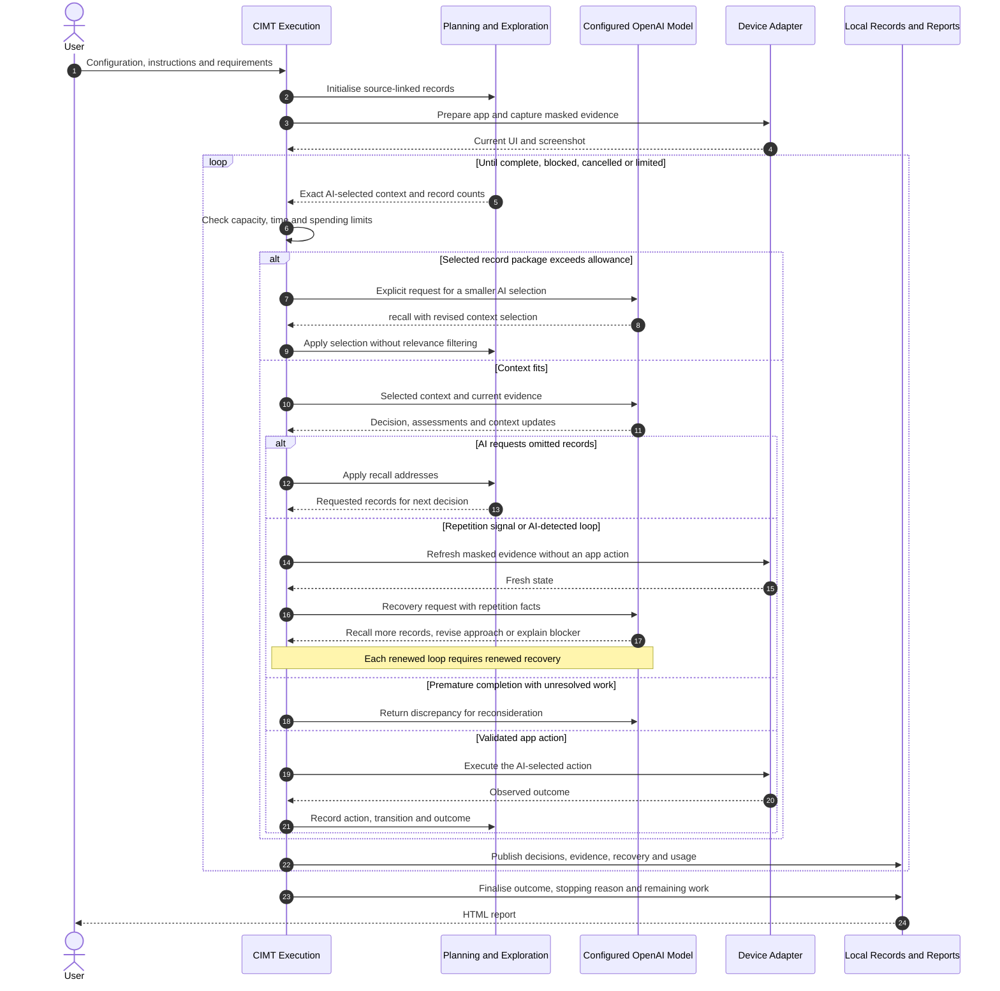

# AI-owned context and recovery

Date: 31 October 2026. Requirements: FR-88–FR-94. Source implementation and offline validation; installation and live acceptance are separate.

## Responsibility

The AI exclusively decides what history and context to retain in working memory, summarise, omit from a request or retrieve. CIMT stores complete records and resolves the AI's exact selections. It does not rank relevance, choose a history window, silently truncate records or choose app recovery actions. Original instructions and requirements remain authoritative. An AI summary is working memory, not a replacement correctness oracle.

The existing Test Planning and Exploration layer owns this policy. ContextMemory applies selections, TestPlan owns task/source identity, ExplorationMemory/ApplicationMap hold observations and LoopRecovery holds recovery requests. Execution owns device calls, storage, report publication, privacy and mechanical resource limits. All inference uses the configured model and shared budget/deadline.

## Context contract

Each response includes context. Returning null explicitly retains the previous AI summary/selection without regenerating it. To change it, return:

```json
{
  "summary": "Settings was visited. Saving has not yet been checked.",
  "includeAll": ["tasks"],
  "records": [
    { "collection": "actions", "id": "latest" },
    { "collection": "states", "id": "@0:3" }
  ]
}
```

Available collections are actions, decisions, observations, screenshots, tasks, paths, states, transitions, requirements, checks, configuration, coverage and routes. The request's catalogue gives their full counts. Bootstrap supplies available records before the AI has made a selection. After that, an empty selection omits historical record content while keeping the AI's summary, collection counts, authoritative instructions and current masked evidence. It does not delete anything locally.

Task, requirement, state and path addresses use their stable IDs. Configuration uses its generated control ID. Actions, accepted decisions, checks and transitions also have zero-based addresses. Every collection accepts @0 for its first record and @3:7 for the exact half-open range selected by AI. Unknown/out-of-range addresses are rejected rather than clipped. latest follows the newest record only when explicitly selected by AI. Routes use the task ID and contain verified observed edges to that task's AI-selected targetState. Empty routes are not evidence of successful navigation.

An action of recall changes context and requests another model decision without a tap, swipe, wait, restart or reset. This lets AI inspect omitted records before acting. Accepted response/selection records remain in decisions, including recall and recovery requests. Device action history remains in actions. observations retains the already captured masked UI data; screenshots exposes stable addresses of saved masked images; the AI can retrieve an older screen without relying on its summary or adding a new device query. Historical pixels are sent only when explicitly selected by AI, are labelled as historical, and must still match the registered image digest. Identical current/historical pixels share one image payload. Evidence-name reuse preserves earlier images instead of replacing them. Retrieval and filtering consume API budget; update the summary/selection with normal decisions when possible instead of adding a separate filtering call to every step.

Current UI evidence, execution scope, fixed permission/safety instructions and collection counts form the protocol frame. These are not a host-selected relevance subset. Current control refs cannot be replaced with old history refs. Full requirement records remain available even when AI omits them from its working context; unresolved catalogue items still prevent complete coverage.

## Capacity and cost

request_context.py limits the serialized selected-record package to 64 KiB. This is a technical byte allowance, not a token estimate or a relevance rule. When exceeded, the entire selected package is deferred and an explicit contextSelectionRequired request supplies the previous AI summary/selection and collection counts with current evidence. The AI must return recall with a smaller selection, or finish blocked with explained remaining work if it cannot proceed. No app action from that response is accepted. Source records remain available through exact/range retrieval; CIMT never chooses which records are relevant.

Provider context limits still apply to the whole request, including mandatory inputs, the current screenshot and explicitly selected historical images. The 64 KiB allowance measures the selected text/record package, not pixel-token usage; it does not cap provider image-token charges. All selected image input remains covered by the existing full-context cost reservation. If mandatory source/evidence cannot fit or an API/transport operation fails, report the actual infrastructure/limit failure instead of silently trimming it. The byte allowance does not guarantee provider acceptance of arbitrary mandatory inputs.

Supported pricing profiles with prompt-cache controls place an explicit cache breakpoint after stable system instructions. Actual reuse depends on provider eligibility and matching context; it is not assumed. Budget records input/output tokens and optional cached-token counts for each settled request. Missing cache details are unavailable, not zero. The conservative accounted spending bound continues to charge validated upper rates without relying on optional cache discounts. Context-selection and recovery requests use the same reservation/cancellation/deadline path as ordinary decisions.

## Recovery contract

Three unchanged attempts or repeated traversals without discovery provide repetition facts. They pause new app actions and request fresh masked evidence and an AI assessment. A signal does not itself prove a functional defect or an unproductive loop. The AI determines whether repetition is intentional and chooses its revised approach. AI may also return recover with recovery id -1, decision replan and a reason to request this workflow before counters signal.

Every pending request has a stable ID. Its response includes:

```json
{
  "id": 0,
  "decision": "replan",
  "reason": "Inspect earlier settings outcomes, then try the unvisited selector."
}
```

Decisions are replan, intentional or blocked. An explanation is required. The AI may issue recall while recovery remains pending. Before another app action or final response it must acknowledge the pending ID. blocked requires done with completion blocked and remaining work. Outside recovery, use id -1, decision none and an empty reason. A valid exact repeatInstruction/repeatReason retains intentional reproduction support.

Each renewed repetition signal opens a new request. There is no fixed three-episode semantic recovery stop. The AI can still make poor choices; time/budget/cancellation bound execution. Schema/source errors retain a separate three-response correction limit. Transport, masking, storage and refusal/incomplete-response failures keep their existing policy. Three matching crashes remain a separate crash-recovery limit. CIMT does not choose a replacement button, restart/reset the app or discard history for loop recovery.

Premature done/complete with unresolved plan, path or requirement work opens the same reconsideration workflow. The AI must continue or explain a blocker. CIMT identifies the contradiction mechanically; it does not select the next test.

## Identity and mapping corrections

Every check names taskId and its source/requirement ID. Display subjects can be redacted without breaking identity. CheckRecorder assigns monotonic check IDs and publishes before image persistence. Valid current-evidence checks from a repetition proposal are recorded before fresh recovery capture, even though its app action is not dispatched. TestPlan applies each check once, keeps a new blocked status when there is no new assessment, and preserves failure/override precedence.

Map identity distinguishes screen structure, observed input values and last-observed configuration. Passive text changes remain full masked UI observations, fingerprints and normal screen evidence without multiplying structural button paths. A changing label is still visible to AI and can be meaningful; the host does not decide its correctness or remove the source observation. Configuration learning refines observed navigation relationships. A changed known value does not globally alias an earlier configuration variant. Verified routes remain guidance and actions always require fresh refs/evidence.

## Reporting and validation

HTML shows AI-selected working context, source-linked tasks, path scope, the application map and AI-directed recovery. Recovery entries identify trigger, reason, AI decision/explanation and waiting/continued/blocked status. A waiting entry after cancellation means no completed recovery decision was recorded. JSON retains full accepted decisions and selections. The run overview includes available input/output/cache counts and request-purpose usage records. Both report boundaries redact text while preserving typed IDs. Historical reports remain unchanged.

Existing offline suites cover AI-only selection, exact paging, action-free retrieval, capacity-only reduction requests, task identity after redaction, historical-check replay, passive status changes, route refinement, repeated recovery beyond three episodes, AI-detected loops, cancellation, reporting and shared accounting. These do not establish live exploration quality or cost savings. Future user-authorised comparisons should measure requirement completion, useful coverage, repeated actions, recovery success, lost evidence, rejected responses, latency and total usage including filtering/recovery. No new CIMT app run is part of this source increment.

## Sequence



## OpenAI guidance used in review

- [Context management](https://developers.openai.com/cookbook/examples/agents_sdk/session_memory): balance useful continuity, context size and summarisation risks.
- [Compaction](https://developers.openai.com/api/docs/guides/compaction): reduce long-running context while carrying forward working state.
- [Tool design](https://developers.openai.com/api/docs/guides/function-calling): keep mechanical work in code and tool contracts clear.
- [Prompt caching](https://developers.openai.com/api/docs/guides/prompt-caching): use eligible stable prefixes and measure actual reuse.
- [Agent evaluation](https://developers.openai.com/api/docs/guides/agent-evals): compare workflow traces and representative outcomes.

Exclusive AI ownership of relevance is CIMT's approved product choice, not an OpenAI requirement or a claim of certified conformance.

## Requirement-to-implementation mapping

| Requirement | Implementation | Existing-suite validation |
| --- | --- | --- |
| FR-88: AI relevance ownership | ContextMemory, TestPlanner, ActionPromptBuilder | ContextSelectionTests, MappingPromptTests |
| FR-89: every detected loop recovers | LoopRecovery, DecisionRecovery, ScenarioRunner | ScenarioTests: repeated recovery, AI-detected loops, recall, blocking and cancellation |
| FR-90: efficient recoverable context | ContextMemory paging/retain, RequestContext, ScenarioEvidence, Agent | ContextCapacityTests, HistoricalImageTests, scenario screenshot selection |
| FR-91: stable task/check identity | TestPlan, CheckRecorder, typed redactors | PlanningRegressionTests, redaction suites |
| FR-92: mapping/progress corrections | screen_model, ApplicationMap, ExplorationMemory | PlanningRegressionTests, existing map/control tests |
| FR-93: reports and usage | PlanningHtmlRenderer, RunDiagnosticsRenderer, Budget | PlanningReportTests, RequestUsageTests, existing policy/CLI suites |
| FR-94: evidence-based qualification | Offline suites and retained request metrics | Offline validation passed; live comparison remains pending |
