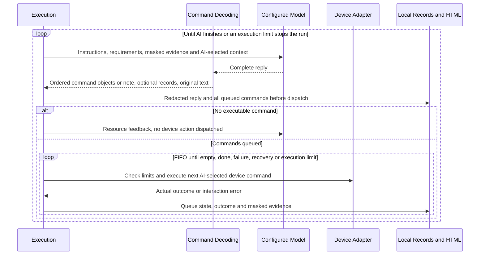

# AI command resources and replies

Updated: 1 November 2026. Describes FR-96/AC-66 and FR-99/AC-69 execution resources; FR-97 defines the input-only layer. This is a source change with offline checks; installation and live acceptance are separate.

## Responsibility

FR-97 supersedes the former reply-reading layer responsibility. [AI Instruction and Context](ai-instruction-context.md) now owns inputs and retained information only, in runtime/ai_instructions/. It queries the confirmed Mobile MCP adapter for fresh masked screen/control information before each instruction request. It does not receive or evaluate replies.

This document describes the separate execution command protocol. runtime/command_reply.py binds explicit commands; runtime/command_queue.py retains their FIFO order and state; Agent owns transport/accounting; AiInteraction coordinates requests and feedback; ActionExecutor executes. Test Planning and Exploration and the evidence store retain information for future instructions. No response approval is delegated to the input layer.

## Resources given to AI

Each request provides the original testing instructions, setup and execution scope, current masked screenshot and UI data, credential aliases, command argument descriptions, and the AI-selected context. The full requirement catalogue and stored history remain available through exact record addresses. The AI can retain its previous context selection, choose another selection, or request records without acting on the app.

CIMT returns actual resource outcomes, including unavailable record addresses and adapter interaction errors. If the selected context exceeds the technical payload allowance, CIMT reports that the entire selected package was deferred. The AI decides what to request next; that notice does not veto a command based on the current evidence. CIMT never chooses a relevant subset.

## Command decoding

The current transport remains the Responses API with text output. This change does not migrate to function calling or add a new service. No strict response schema is requested from the provider.

The reply supplies readable JSON command objects containing action and its needed arguments. One object, an array of objects or consecutive objects are accepted in received order. For example:

```json
{"action":"tap","ref":"@previously-seen-control"}
```

Plan updates, checks, context selections and recovery acknowledgements are optional. Missing fields receive mechanical defaults for the existing dispatcher. Unknown or differently shaped fields remain in the complete original reply even when they cannot be bound to a typed record. A sparse or inconsistent report does not discard an executable command.

FR-99 supersedes the former single-object limitation. The decoder reads the explicit objects into a scenario-local FIFO queue. Execution takes each in order without another inference request while commands remain pending. A readable prefix survives an unreadable suffix; the unreadable text is retained as a note. Prose is not searched for embedded commands. No readable command results in a note with resource feedback rather than a guessed device action. There is no response-format exhaustion stop. Shared time, spending and cancellation still apply.

Each device action retains normal startup/foreground checks, dispatch and post-action observation. If a command cannot execute, execution cancels all pending commands before observation and retains the actual issue. The next normal AI request includes the failed command/batch/order, actual error and cancelled-command count, even when no commands remained. Successful batches add no acknowledgement request; normal next decisions continue testing. Recovery can leave the tail not executed. AI can retrieve cancelled/unexecuted records and decide what new commands to issue. Shared stopping/privacy rules can prevent a further provider request; issues remain locally. A first-command done can end the objective; a done behind commands instead returns actual results for a fresh decision under FR-101. recover requests fresh evidence and a decision. Notes/recall have no device action. See [queue state and boundaries](command-queue.md).

Supported-command arguments, platform capabilities, coordinate bounds, credential destinations and privacy are mechanical execution constraints. Provider refusals, incomplete provider responses and transport failures keep their existing infrastructure policy. Removing response evaluation does not make an unavailable resource usable or permit an unmasked image or secret to reach AI.

## Planning, findings and recovery

AI task, path and requirement references are stored without semantic approval. Known IDs link records mechanically. An unavailable reference remains unbound and must not update an unrelated catalogue item or become proof of an observed control. Missing local numeric task IDs receive distinct storage IDs. Original AI text remains available for review.

CIMT reports the AI's findings and keeps known failures, crashes and unresolved work visible. It does not judge whether an explanation or quotation is correct. An unfamiliar result cannot manufacture a passed verdict. AI may finish when it chooses; the report still shows any recorded unresolved work and marks completion incomplete. No host-selected reconsideration call is added merely because a finish conflicts with the plan.

Repetition facts recorded after execution are supplied as AI-directed recovery information with fresh masked evidence in the next instruction. They do not veto a chosen command. The AI chooses its next approach. A command does not need a matching structured recovery acknowledgement. Notes and recall requests leave recovery pending; they are not recorded as device actions or completed recovery commands.

## Evidence and report

The queue saves every command before dispatch and retains the full reply under modelResponse once per batch after secret redaction. Dequeued decisions keep their command/batch/order identities. HTML exposes it in “AI replies and resource feedback”, escaped as text. The AI command queue shows order, actual execution state, step and reason. Optional typed planning and check records remain separately readable. AI prose is not proof of execution: only actual dispatcher outcomes add device actions and observed transitions.

Older reports may contain Unaccepted AI responses from the removed correction policy. They are historical evidence and are not rewritten. New execution does not produce that evaluation or its rejection/exhaustion events. Instructions, requirements, screenshots and runtime outcomes continue through the existing privacy and evidence boundaries.

## Verification

The existing Python suites cover minimal commands, optional records, unbound IDs, unavailable context addresses, more than three note replies followed by a command, shared limits, fresh evidence after an actual action and privacy. The existing .NET report tests verify escaped and redacted full replies and resource feedback. CLI and build fixtures remain offline. These checks do not establish live model compliance, exploration quality, latency or cost savings.



FR-101 supplies complete new batch paths and current ANR warnings outside optional history deferral. This is mandatory execution feedback, not host relevance filtering. Historical batches remain available by exact AI-selected batches addresses. See [batch feedback and continuation](batch-feedback.md).
