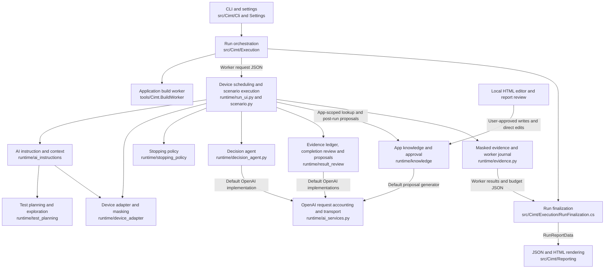
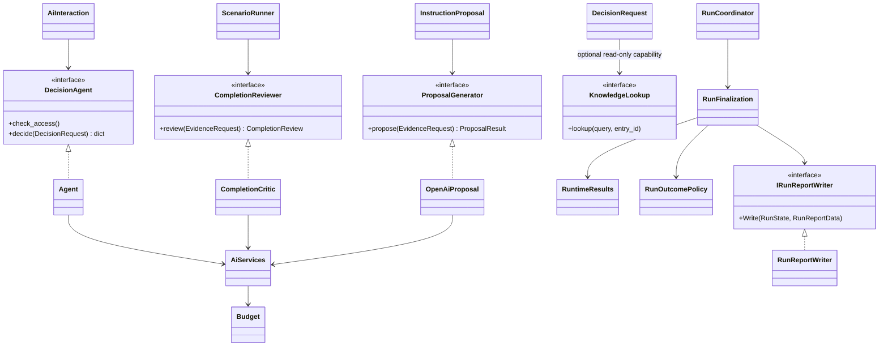
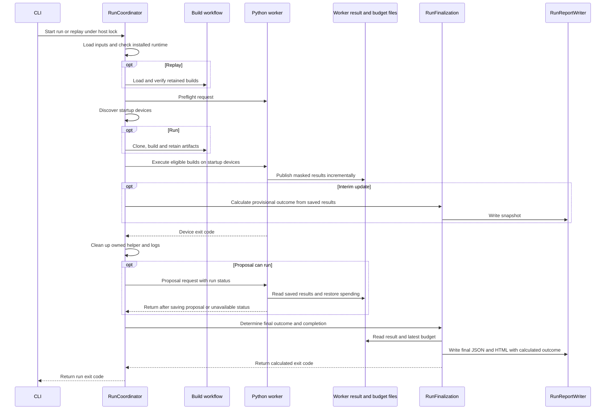
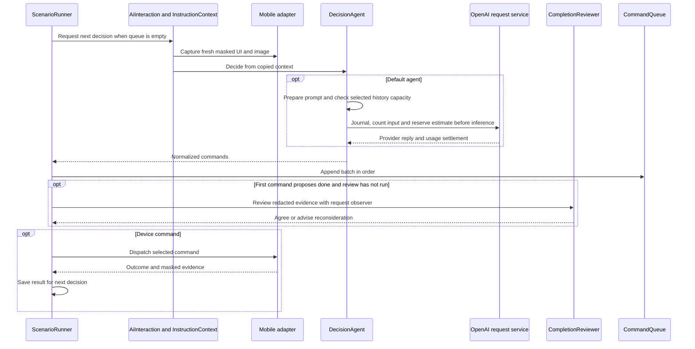

# Current CIMT architecture diagrams

These diagrams describe the source implementation. [Architecture decisions](architecture.md) preserve the design history. The [worker protocol](worker-protocol.md) specifies the host and worker handoff.

## Layers and dependencies

Execution owns the device, action queue, scenario state and stopping. Planning interprets supplied records as retained AI plans and exploration history. Instruction preparation pulls in that history and a fresh masked observation. The decision agent returns commands. The reviewer can advise reconsideration once. The proposal generator drafts guidance after device execution. The default AI implementations share request accounting and the run budget. The host also uses the Mobile MCP helper for discovery and cleanup. The [device adapter review](device-adapter.md#replacement-boundaries) identifies both replacement boundaries.

## Class and interface diagram

DecisionRequest carries copied context plus shared execution hooks. EvidenceRequest carries redacted evidence, the request observer and a cancellation check for in-run review. ProposalResult and CompletionReview define the expected reply fields. AiServices records requests and accounts for usage. Each default AI implementation supplies the prompt and handles its own reply. The proposal worker restores the persisted run budget. When Learning is enabled, the decision request also exposes app-scoped knowledge lookup through a read-only capability. The knowledge layer owns the local database, report review transactions, and standalone editor. Approval and direct edits never pass through the decision agent.

## Run, replay and finalization sequence

On a stopped or failed run, the host proceeds to cleanup and finalization with the evidence available. See [run engine](run-engine.md) for eligibility and exit rules.

## Decision sequence

See [command queue](command-queue.md) for deferred finish, failure and recovery handling. See [decision agent](decision-agent.md) for replacement limits.
