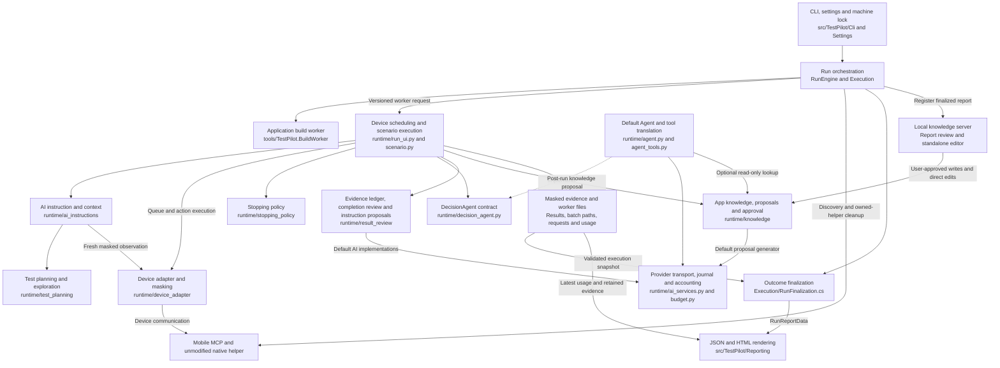
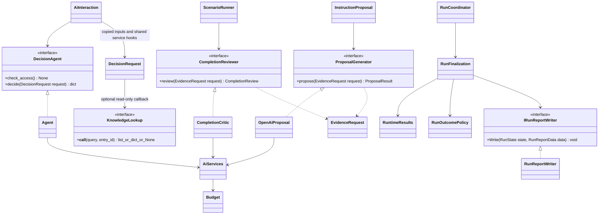
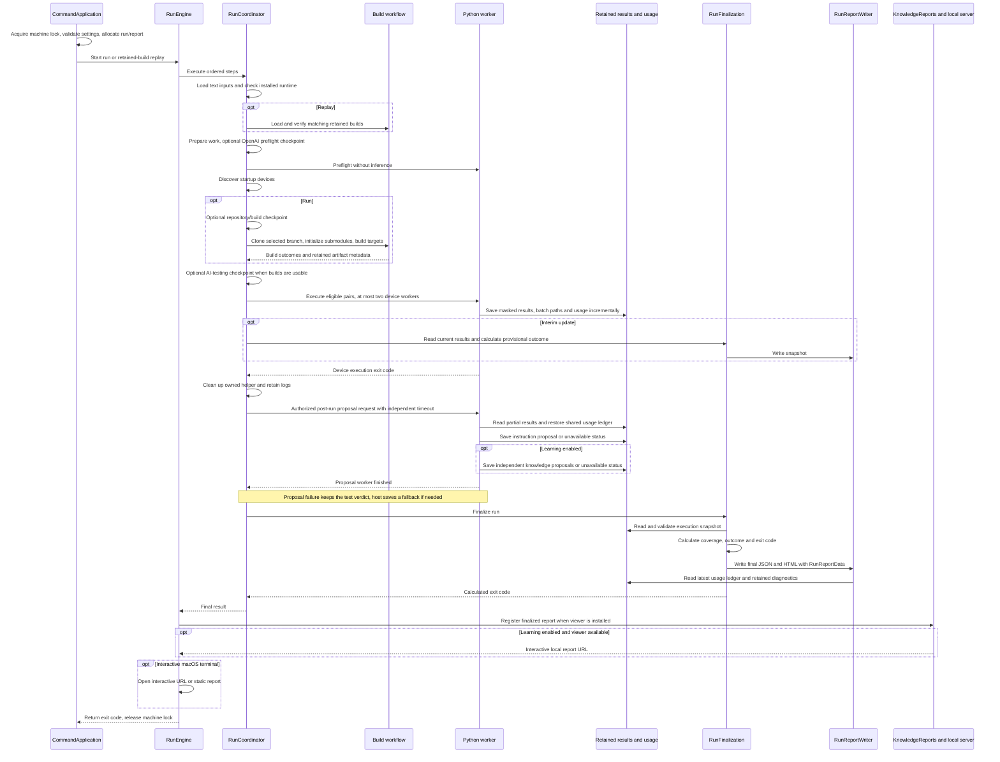
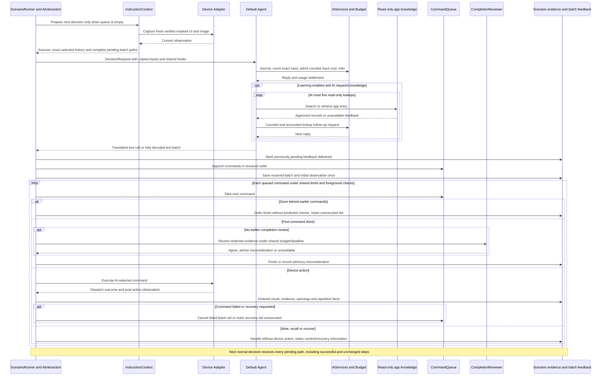
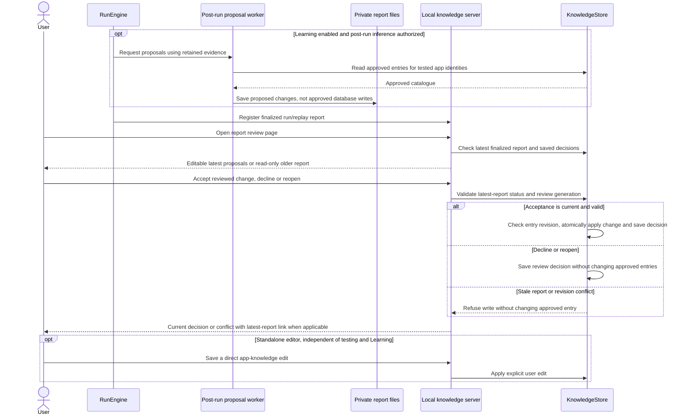

# Current TestPilot architecture diagrams

Reviewed: 26 November 2026 against `main` at `b2b9ced`, with the documentation corrections in this PR. These diagrams describe implemented responsibilities and flows, not future acceptance claims. [Architecture decisions](architecture.md) preserve design history; later approved [requirements](requirements.md) supersede earlier increments. The [alignment review](reviews/2026-11-26-uml-alignment.md) links requirements, source and validation.

## Layers and dependencies

Execution owns the queue, device actions, scenario state and stopping. The four dedicated runtime layers keep their separate folders under DR-01. Planning stores supplied observations and AI-owned plans/selections; it does not choose tests. The input layer queries fresh masked observations and assembles context; it does not decode replies or dispatch actions. Device Adapter owns device I/O and readiness, while Stopping Policy owns failure scope. The other boxes are components and contracts, not additional layers.

The default agent translates registered tool calls or text replies into commands. Tool translation does not operate the device. Completion review is advisory and runs at most once per scenario. Instruction and optional knowledge proposals run after cleanup using retained evidence. All default AI services use the configured model and shared ledger; post-run proposals have separate bounded time windows and may exceed the testing budget under FR-24. See [device replacement boundaries](device-adapter.md#replacement-boundaries).

## Class and interface diagram

These Python interfaces are structural `Protocol` contracts. `KnowledgeLookup` is callable, not an object with a `lookup` method: its keyword-only arguments default to empty strings and its return type is `list | dict | None`. `DecisionRequest` carries copied context plus shared recording, budget, deadline and cancellation hooks. `EvidenceRequest` carries redacted evidence, an optional request observer and cancellation check. `CompletionReview` and `ProposalResult` specify the independent review/proposal replies. Knowledge proposal generation is a separate implementation in `runtime/knowledge/proposals.py`; it is not an implementation of `ProposalGenerator`.

## Run, replay and finalization sequence

Exceptions skip later execution steps but still reach cleanup, proposal/fallback and finalization where possible. A configured interactive checkpoint can prevent proposal inference if AI testing was never authorized. Hard process termination or storage failure cannot guarantee finalization. Viewer registration/browser failures do not change the calculated test outcome. Replay reuses retained artifacts and runs current instructions; saved-action adaptation remains unfinished. See [run engine](run-engine.md) and [worker protocol](worker-protocol.md).

## Decision sequence

The loop ends on batch handoff, recovery, AI finish or an execution stop; it does not run an unexecuted tail. A malformed text reply becomes a retained note with mechanical feedback; no prefix is dispatched. Output-limit replies allow one separately accounted shorter retry. The SDK stops at the first registered tool call and execution owns its command. There is no local history-size gate, relevance filter or semantic approval of an action. See [command queue](command-queue.md), [batch feedback](batch-feedback.md) and [decision agent](decision-agent.md).

## Knowledge review and persistence sequence

Static report files retain proposals and links. Only the local server handles writes; opening static HTML does not approve anything. The installation-local database persists across test folders. Declining/reopening preserves approved entries; acceptance alone applies a proposed change. Current test instructions remain authoritative over stored knowledge.
