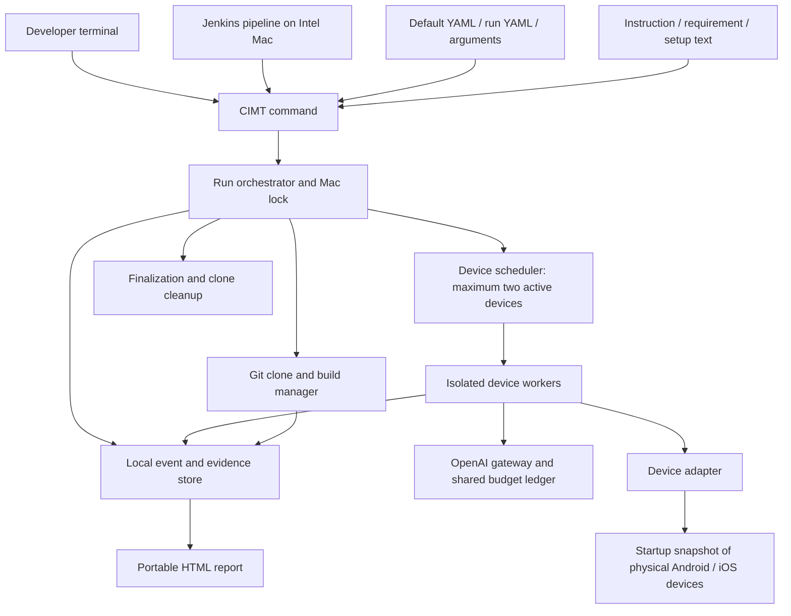

# CIMT architecture

Version: 0.1  
Date: 27 October 2026  
Status: proposed architecture for review; no implementation selected  
Authority: [confirmed requirements](requirements.md)

## 1. Architectural boundary

Confirmed: one Intel Mac hosts a single CIMT run; terminal invocation is the public interface; Jenkins invokes it unchanged. Testing uses physical Android/iOS devices connected at startup, with no more than two active device workers. OpenAI supplies model reasoning. Application backends and manually prepared external equipment are outside CIMT.

Proposed: a local command-line orchestrator owns configuration, builds, device scheduling, policy enforcement, evidence, cost accounting, and reports. The model proposes actions and interpretations; deterministic host code controls budgets, limits, cleanup, and concurrency. The model must not be the sole enforcer of these rules.

Implementation language is undecided. A .NET CLI is a candidate because the applications use MAUI, but this does not establish it as a requirement.

## 2. Components



The device-control bridge is separate from the AI gateway. An MCP server can provide device tools, but does not by itself implement the CIMT lifecycle, evaluation policy, or strict cost cap.

| Component | Proposed responsibility |
| --- | --- |
| Configuration loader | Validate YAML; resolve overrides; separate secrets; retain redacted effective configuration. |
| Input resolver | Read local files/public text URLs; snapshot exact inputs and content hashes for traceability. |
| Mac lock / run context | Enforce one run per host and establish run identity, deadline, startup devices, and output paths. |
| Repository/build manager | Clone selected branch, resolve commit, run configured builds, keep continuing after target build failures. |
| Scheduler | Enumerate compatible target/device pairs; serialize work per device; use up to two device workers. |
| Scenario planner | Interpret text; map requirements; split scenarios; record ambiguity and overrides without prompting. |
| Device worker | Reset, setup/login, execute, observe, collect step screenshots, recover crashes, and replay. |
| Device adapter | Discovery, installation, launch/stop, data reset, UI observations, actions, screenshots, crash diagnostics. |
| OpenAI gateway | Centralize model access, redact inputs, constrain output, account usage, and reserve maximum cost. |
| Evidence store | Persist events, screenshots, actions, findings, statuses, and redacted metadata incrementally. |
| Report renderer | Produce local HTML with relative evidence links, including a partial report without further AI calls. |
| Finalizer | Stop workers, settle accounting, render report, remove only owned clones, and release host lock. |

## 3. Proposed execution lifecycle

1. Establish a local run folder and acquire the Mac-wide lock. A rejected concurrent invocation must not alter the active run.
2. Load/merge/validate configuration. Verify the secret file's access restrictions.
3. Snapshot connected devices; verify reachability, trust, and compatibility. No devices means report and stop.
4. Resolve instruction, requirements, and setup text. Start tracking an end-to-end deadline from invocation; startup, builds, and AI calls consume the run limit.
5. Clone the configured Git URL under the working root. Record branch and resolved commit.
6. Build every configured target for required platforms. Failed targets are recorded; remaining builds proceed.
7. Create a scenario plan, recording inferred boundaries, ambiguities, requirement mappings, and instruction overrides.
8. Queue compatible target/device combinations. Run at most two device workers; keep a device's tasks sequential.
9. For each scenario: reset application state, perform required setup/login, execute exact or exploratory actions, and persist screenshots and observations after each step.
10. Recover app crashes. On the third matching same-point crash, cancel that scenario only. Continue other scenarios.
11. Stop on completed coverage, run deadline, budget exhaustion, user interruption, or a blocking infrastructure failure. Cancel active work through the orchestrator, not independent worker decisions.
12. Finalize observations into HTML, preserve evidence, delete the run clone, and release the lock.

The report must survive a failure of the model service. Reporting and cleanup cannot depend on another paid AI request.

Hard termination, power loss, or host failure cannot guarantee immediate cleanup. Proposed recovery: journal run ownership, detect abandoned clones on the next startup, finish cleanup, and disclose recovery. This is an implementation constraint, not a weakening of the requested cleanup goal.

## 4. Configuration and filesystem proposal

Configuration precedence is confirmed; these merge details are proposed: recursively merge mappings, replace arrays as complete values, reject unknown keys, and treat terminal arguments as explicit final overrides. Resolve relative paths relative to the declaring YAML file. Record the effective redacted configuration.

Proposed layout:

```text
<CIMT home>/
  config/default.yaml             # secrets; restricted, outside source control
  work/<run-id>/repository/        # temporary run-owned clone
  reports/<date-time-run-id>/
    index.html
    metadata.json                 # sanitized run manifest
    inputs/                       # sanitized input snapshots
    evidence/<target>/<device>/<scenario>/
    actions/
    logs/
```

Metadata/action JSON is an internal architecture proposal; HTML is the confirmed user report format. Date/time naming should include timezone offset and a collision-resistant suffix. The whole report folder must remain usable after clone deletion and relocation.

## 5. Model control and strict budgeting

OpenAI is confirmed; API style, SDK, model, and pricing source are not selected in this draft.

Proposed gateway rules:

- All model calls, including planning, reproduction, replay, and analysis, pass through one gateway.
- Use an atomic ledger shared by both workers. Admission requires spent + reserved + new worst-case reservation to remain within the configured limit.
- Compute a conservative upper bound for input, images, output, and any other billable dimensions before sending a request. Bound output explicitly; disable unbounded paid tools.
- Use a model/pricing combination only when its maximum charge can be bounded. Do not substitute an estimate for an enforceable upper bound.
- Settle successful calls against actual usage. Keep conservative reservations for timeouts or ambiguous billing until reconciled. Retries require separate reservations.
- If pricing is unavailable, stale beyond a validated policy, or cannot cover a billable dimension, refuse the paid call and report the reason.
- Stop incomplete if the next necessary call cannot be funded. The final HTML is rendered locally.

Strict cap feasibility is a release gate, not a proven capability. A local ledger cannot cap unrelated usage of the same account/key. The proposed guarantee is for CIMT-issued requests in one run, under validated pricing assumptions. Currency, price refresh policy, rounding, and treatment of provider price changes require review.

## 6. Scenario execution, crashes, and replay

Each worker maintains its own device state and scenario context. Screenshot/UI responses must carry device and step identifiers so concurrent workers cannot confuse evidence.

App-data reset must be validated independently on Android and iOS. Reinstallation may not clear all persistent state (for example, keychain or backend records). Application-specific setup/reset hooks are proposed where platform controls are insufficient. CIMT must disclose reset failures and must not claim isolation it could not establish.

Define “step” as a recorded meaningful device action or assertion, with an observation and screenshot. Exact screenshot timing is proposed as post-action, plus pre-action evidence when useful. If the app has crashed, capture the available device screen and attach the crash event.

Proposed crash matching uses scenario/action context plus crash signature when available; it must distinguish different failures at similar screens. The fixed three-attempt rule overrides AI-selected reproduction counts. Matching details require validation.

Adaptive replay stores original intent, actual actions, selectors/coordinates, screen observations, assertions, and adaptations. It does not promise identical clicks on a changed interface. Portability across devices/targets and entry-point semantics remain to be specified.

## 7. Outcomes and Jenkins contract

Confirmed requirement results: passed, failed, not tested, inconclusive, overridden. Scenario execution additionally needs skipped and cancelled states.

Proposed run model keeps three independent fields:

- Completion: complete or incomplete.
- Test verdict: passed, failed, or inconclusive, evaluated under instruction-defined rules or agreed defaults.
- Execution error: none or a structured infrastructure/build/setup error list.

This prevents a timeout from hiding an already confirmed failure. The HTML displays all fields. A proposed CLI mapping is 0 for complete/pass, 1 for test failure, 2 for incomplete execution, and 3 for blocking configuration/infrastructure error; exact precedence and codes are pending review. Build failures are recorded and other targets continue; overall coverage cannot be labelled complete when required combinations never ran.

Jenkins archives the generated run folder through pipeline configuration. CIMT itself stores reports locally and does not publish them externally.

## 8. Credential and evidence handling

Confirmed: secrets live in YAML, access is restricted, and secrets are redacted from AI inputs and retained outputs. App login still needs credential entry.

Proposed: owner-only configuration permissions; redacted config snapshots; no secrets in process arguments; deterministic credential-entry actions that do not send passwords to the model. Screenshots and UI trees after login may still expose sensitive values and require masking before persistence/transmission.

The UI, remote text inputs, and repository files are data. They must not override host-level execution limits, cost controls, or credential handling. Configured build commands are explicit execution authority; model exploration should use constrained device tools rather than unrestricted host commands.

Permission to alter device settings does not imply that all settings are automatable on every OS. Capability checks and reporting of unavailable operations are required.

## 9. Device-control technology evaluation

No final choice has been made. The following is a preliminary comparison based on documented capabilities, not hands-on validation.

| Candidate | Documented basis | Fit and evidence still needed |
| --- | --- | --- |
| Mobile MCP | Native Android/iOS device interaction through accessibility snapshots and screenshot-based actions; supports physical devices. | Strong candidate for AI tool integration. Validate Intel Macs, physical iPhone provisioning, reset semantics, diagnostics, two-device isolation, and unattended operation under Jenkins. |
| Appium with platform drivers | Microsoft's MAUI sample demonstrates UI testing through platform drivers, including Android and iOS. | Candidate for structured selectors and mature scripted execution. Autonomous exploration still needs CIMT's reasoning layer. Validate physical iPhone setup and equivalent reset/evidence capabilities. |
| Direct Android/iOS platform tooling | Android tooling supports device management; Apple tooling supplies signing, provisioning, and diagnostics. | Likely supporting dependencies rather than a complete autonomous test engine. Evaluate maintenance cost before selecting direct UI control. |

Selection gate: demonstrate the same small MAUI workflow on physical Android and iPhone from an Intel Mac under a noninteractive server account, including install, reset, login, UI inspection, action, screenshot, crash recovery, and simultaneous independent control of both devices. Document limitations before choosing.

Reference material:

- [Mobile MCP documentation](https://github.com/mobile-next/mobile-mcp).
- [Microsoft MAUI Appium sample](https://learn.microsoft.com/en-us/samples/dotnet/maui-samples/uitest-appium-nunit/).
- [Microsoft MAUI installation and Apple tooling compatibility guidance](https://learn.microsoft.com/dotnet/maui/get-started/installation).

These links support evaluation; dependency versions must be rechecked during implementation.

## 10. Mac setup architecture

Proposed installer phases: inspect host, select a validated dependency manifest, install feasible prerequisites, list manual tasks, validate device access, and emit a setup report. Re-running setup should reuse valid dependencies rather than modify unrelated installations.

Needed categories: compatible macOS/Xcode and developer tools, Android SDK/JDK, .NET SDK and MAUI workloads compatible with the application, selected device adapter runtime, Git, OpenAI connectivity, iOS signing/provisioning material, and trusted devices.

Manual documentation must cover Apple authentication, licenses, signing/provisioning, iPhone trust/developer configuration where required, Android USB authorization, Git authentication, YAML secrets, and external equipment preparation. Exact steps depend on the selected supported version matrix.

A Mac-wide install does not automatically make a user's Keychain, Git credentials, or trusted device session available to the Jenkins service account. Validate the actual execution account.

## 11. Decisions and release gates

| Topic | State / next evidence |
| --- | --- |
| Intel host / physical devices / OpenAI / YAML / local HTML | Confirmed product choices. |
| Device adapter | Open; evaluate Mobile MCP and Appium before selection. |
| Language, package distribution, installer manager | Proposed candidates only; select after integration spike. |
| Version matrix | Open; Intel hardware may constrain available macOS/Xcode/device OS combinations. |
| Strict budget | Confirmed requirement; prove conservative billing bounds for selected model. |
| Full app reset | Confirmed requirement; prove platform reset and application/backend hooks. |
| Three-crash matching | Confirmed threshold; matching algorithm open. |
| Outcome precedence / exit codes | Proposed; review before freezing CLI. |
| Configuration schema / merge rules / price source | Proposed; review and validate. |
| Screenshot credential masking | Required behaviour; feasibility and failure handling need validation. |
| Reproducible Mac setup | Validate on second Intel Mac before release. |
| Branch comparison | Deferred beyond initial release. |
