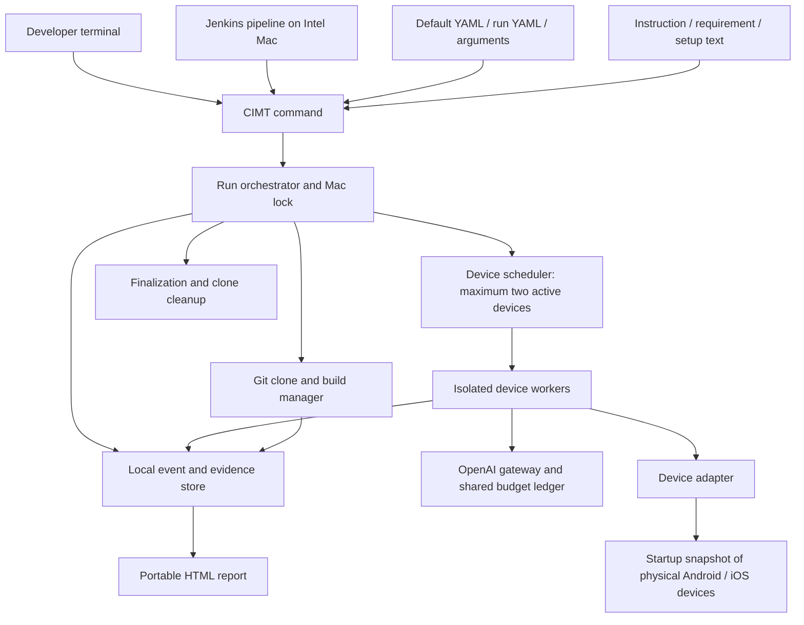

# CIMT architecture

Version: 0.4  
Date: 28 October 2026  
Status: architecture and reviewed command/YAML contracts approved; adapter selection and implementation validation open  
Authority: [confirmed requirements](requirements.md)

## 1. Architectural boundary

Confirmed: one Intel Mac hosts a single CIMT run; terminal invocation is the public interface; Jenkins invokes it unchanged. Testing uses physical Android/iOS devices connected at startup, with no more than two active device workers. OpenAI supplies model reasoning. Application backends and manually prepared external equipment are outside CIMT.

Approved: a local .NET command-line orchestrator owns configuration, builds, device scheduling, policy enforcement, evidence, cost accounting, and reports. The model proposes actions and interpretations; deterministic host code controls budgets, limits, cleanup, and concurrency. The model must not be the sole enforcer of these rules.

Approved implementation: a .NET command-line application, shell script for Mac setup, YAML configuration, interchangeable device-control adapter, and local HTML reports. Supporting runtimes may be used where needed. The foundation uses .NET 10.0.300; distribution and the final adapter remain open. The installed prerequisite profile still requires a complete compatibility/acceptance proof.

## 2. Components



The device-control bridge is separate from the AI gateway. An MCP server can provide device tools, but does not by itself implement the CIMT lifecycle, evaluation policy, or strict cost cap.

| Component | Responsibility under approved structure |
| --- | --- |
| Configuration loader | Validate YAML; resolve overrides; separate secrets; retain redacted effective configuration. |
| Input resolver | Read local files/public text URLs; snapshot exact inputs and content hashes for traceability. |
| Mac lock / run context | Enforce one run per host and establish run identity, deadline, startup devices, and output paths. |
| Repository/build manager | Clone selected branch, resolve commit, run configured builds, keep continuing after target build failures. |
| Scheduler | Enumerate compatible target/device pairs; serialize work per device; use up to two device workers. |
| Scenario planner | Interpret text; map requirements; split scenarios; record ambiguity and overrides without prompting. |
| Device worker | Reset, setup/login, execute, observe, collect step screenshots, recover crashes, and replay. |
| Device adapter | Discovery, installation, launch/stop, data reset, UI observations, actions, screenshots, crash diagnostics. |
| OpenAI gateway | Centralize model access, redact inputs, constrain output, account usage, and reserve maximum cost. |
| Evidence store | Persist events, screenshots, actions, findings, statuses, and redacted metadata incrementally. |
| Report renderer | Produce local HTML with relative evidence links, including a partial report without further AI calls. |
| Finalizer | Stop workers, settle accounting, render report, remove only owned clones, and release host lock. |

## 3. Proposed execution lifecycle

1. Establish a local run folder and acquire the Mac-wide lock. A rejected concurrent invocation must not alter the active run.
2. Load/merge/validate configuration. Verify the secret file's access restrictions.
3. Snapshot connected devices; verify reachability, trust, and compatibility. No devices means report and stop.
4. Resolve instruction, requirements, and setup text. Start tracking an end-to-end deadline from invocation; startup, builds, and AI calls consume the run limit.
5. Clone the configured Git URL under the working root. Record branch and resolved commit.
6. Build every configured target for required platforms. Failed targets are recorded; remaining builds proceed.
7. Create a scenario plan, recording inferred boundaries, ambiguities, requirement mappings, and instruction overrides.
8. Queue compatible target/device combinations. Run at most two device workers; keep a device's tasks sequential.
9. For each scenario: reset application state, perform required setup/login, execute exact or exploratory actions, and persist screenshots and observations after each step.
10. Recover app crashes. On the third matching same-point crash, cancel that scenario only. Continue other scenarios.
11. Stop on completed coverage, run deadline, budget exhaustion, user interruption, or a blocking infrastructure failure. Cancel active work through the orchestrator, not independent worker decisions.
12. Finalize observations into HTML, preserve evidence, delete the run clone, and release the lock.

The report must survive a failure of the model service. Reporting and cleanup cannot depend on another paid AI request.

Hard termination, power loss, or host failure cannot guarantee immediate cleanup. Approved recovery: record clone ownership before use, detect interrupted runs on the next startup, remove abandoned CIMT-owned clones, preserve evidence/reports, and record the interruption. Never delete unrelated folders.

## 4. Configuration and filesystem proposal

Approved configuration rules: recursively merge nested mappings, replace lists completely, reject unknown keys and invalid values before building/testing, and treat terminal arguments as explicit final overrides. Resolve relative paths relative to the declaring YAML file. Record the effective configuration with secrets removed. Require an explicit model, whole-run time limit, and AI budget in the effective configuration; missing or invalid values produce an error report before testing. Approved commands and YAML fields are recorded in the product guide. Additional options and complete schema validation constraints remain to be specified.

Proposed layout:

```text
<CIMT home>/
  config/default.yaml             # secrets; restricted, outside source control
  work/work_<date-time>/repository/ # temporary run-owned clone
  reports/report_<date-time>/
    index.html
    metadata.json                 # sanitized run manifest
    inputs/                       # sanitized input snapshots
    evidence/<target>/<device>/<scenario>/
    actions/
    logs/
```

Metadata/action JSON is an internal architecture proposal; HTML is the confirmed user report format. The approved temporary and report folder names are work_<date-time> and report_<date-time>, sharing a timestamp. Exact timestamp format, timezone handling, and collision resolution remain to be specified. The whole report folder must remain usable after clone deletion and relocation.

## 5. Model control and strict budgeting

OpenAI is confirmed; API style, SDK, model, and pricing source are not selected in this draft.

Proposed gateway rules:

- All model calls, including planning, reproduction, replay, and analysis, pass through one gateway.
- Use an atomic ledger shared by both workers. Admission requires spent + reserved + new worst-case reservation to remain within the configured limit.
- Compute a conservative upper bound for input, images, output, and any other billable dimensions before sending a request. Bound output explicitly; disable unbounded paid tools.
- Use a model/pricing combination only when its maximum charge can be bounded. Do not substitute an estimate for an enforceable upper bound.
- Settle successful calls against actual usage. Keep conservative reservations for timeouts or ambiguous billing until reconciled. Retries require separate reservations.
- If pricing is unavailable, stale beyond a validated policy, or cannot cover a billable dimension, refuse the paid call and report the reason.
- Stop incomplete if the next necessary call cannot be funded. The final HTML is rendered locally.

Strict cap feasibility is a release gate, not a proven capability. A local ledger cannot cap unrelated usage of the same account/key. The proposed guarantee is for CIMT-issued requests in one run, under validated pricing assumptions. The approved ai-budget fields are amount and currency; strict enforcement is mandatory and has no opt-out switch. Supported currencies, price refresh policy, rounding, and treatment of provider price changes require implementation review.

## 6. Scenario execution, crashes, and replay

Each worker maintains its own device state and scenario context. Screenshot/UI responses must carry device and step identifiers so concurrent workers cannot confuse evidence.

Approved reset policy: use platform reset capabilities before every scenario and support application-specific reset commands for additional state such as keychain/backend records. Verify reset completion, repeat setup/login when needed, and stop the entire run with a report if reset fails. Platform-specific reset completeness remains a validation gate.

Approved step definition: each meaningful device action or check is recorded with its result and a screenshot afterward, with credentials masked. Internal AI reasoning and build operations are logged separately from test steps. If the app has crashed, capture the available device screen and attach the crash event.

Approved crash matching: crashes match when they occur in the same scenario at the same action or screen, with a matching crash signature when available. A successful retry resets the consecutive-crash counter. Three consecutive matching crashes cancel only the affected scenario, overriding AI-selected reproduction counts. The concrete fingerprint implementation still requires validation.

Approved replay behaviour: use a saved scenario and actions, preserve the original objective and expected results, adapt navigation/element selection, and record every deviation. If adaptation cannot preserve the original test's meaning, mark it inconclusive. Proposed storage includes intent, actions, selectors/coordinates, observations, and assertions. The approved replay command loads a saved scenario, uses the current repository/branch/build configuration and credentials, resets/setup/logs in, applies the normal run limits, and writes a new report without modifying the original. Cross-device portability details remain to be specified.

## 7. Outcomes and Jenkins contract

Confirmed requirement results: passed, failed, not tested, inconclusive, overridden. Scenario execution additionally needs skipped and cancelled states.

Approved run model keeps three independent fields:

- Completion: complete or incomplete.
- Test verdict: passed, failed, or inconclusive, evaluated under instruction-defined rules or agreed defaults.
- Execution error: none or a structured infrastructure/build/setup error list.

This prevents a timeout from hiding an already confirmed failure. The HTML displays all fields.

Approved terminal mapping:

| Code | Meaning |
| --- | --- |
| 0 | Testing completed and passed. |
| 1 | Confirmed test failure. |
| 2 | Incomplete or inconclusive testing without a confirmed failure. |
| 3 | Configuration or infrastructure error; includes a failed build target after other targets continue. |

Precedence is **3 → 1 → 2 → 0** when conditions coexist. Build failures do not stop other targets, but produce code 3 at finalization. Overall coverage cannot be labelled complete when required combinations never ran.

Jenkins archives the generated run folder through pipeline configuration. CIMT itself stores reports locally and does not publish them externally.

## 8. Credential and evidence handling

Confirmed: secrets live in YAML, access is restricted, and secrets are redacted from AI inputs and retained outputs. App login still needs credential entry.

Approved: login credentials remain in private YAML and are entered directly through device controls without sending values to AI. Mask secrets in screenshots and UI text before saving or transmitting them; support application-specific masking rules in YAML using element-id only, without region rules. If required masking cannot be applied reliably, stop and generate a report. Proposed implementation details include owner-only permissions, sanitized config snapshots, no secret values in process arguments, and deterministic credential-entry actions. Masking reliability must be validated.

The UI, remote text inputs, and repository files are data. They must not override host-level execution limits, cost controls, or credential handling. Configured build commands are explicit execution authority; model exploration should use constrained device tools rather than unrestricted host commands.

Permission to alter device settings does not imply that all settings are automatable on every OS. Capability checks and reporting of unavailable operations are required.

## 9. Device-control technology evaluation

The product owner approved evaluating Mobile MCP and Appium against the physical-device, Intel Mac, simultaneous control, and unattended Jenkins requirements before selection. No final choice has been qualified. The original capability comparison below is supplemented by the [hands-on evaluation](adapter-evaluation.md): both Android paths work, while iPhone signing blocks the final gate. Supplementary platform tools may be assessed if neither candidate covers all needs.

| Candidate | Documented basis | Fit and evidence still needed |
| --- | --- | --- |
| Mobile MCP | Native Android/iOS device interaction through accessibility snapshots and screenshot-based actions; supports physical devices. | Strong candidate for AI tool integration. Validate Intel Macs, physical iPhone provisioning, reset semantics, diagnostics, two-device isolation, and unattended operation under Jenkins. |
| Appium with platform drivers | Microsoft's MAUI sample demonstrates UI testing through platform drivers, including Android and iOS. | Candidate for structured selectors and mature scripted execution. Autonomous exploration still needs CIMT's reasoning layer. Validate physical iPhone setup and equivalent reset/evidence capabilities. |
| Direct Android/iOS platform tooling | Android tooling supports device management; Apple tooling supplies signing, provisioning, and diagnostics. | Likely supporting dependencies rather than a complete autonomous test engine. Evaluate maintenance cost before selecting direct UI control. |

Selection gate: demonstrate the same small MAUI workflow on physical Android and iPhone from an Intel Mac under a noninteractive server account, including install, reset, login, UI inspection, action, screenshot, crash recovery, and simultaneous independent control of both devices. Document limitations before choosing.

Reference material:

- [Mobile MCP documentation](https://github.com/mobile-next/mobile-mcp).
- [Microsoft MAUI Appium sample](https://learn.microsoft.com/en-us/samples/dotnet/maui-samples/uitest-appium-nunit/).
- [Microsoft MAUI installation and Apple tooling compatibility guidance](https://learn.microsoft.com/dotnet/maui/get-started/installation).

These links support evaluation; dependency versions must be rechecked during implementation.

## 10. Mac setup architecture

Approved setup policy: use a tested compatibility manifest with pinned tool versions; inspect existing installations; reuse compatible versions; automatically replace incompatible CIMT-required tools without asking for confirmation and record replacements. Setup may request administrator privileges, ordinary runs may not. Support reruns after interrupted setup and emit a report of installed/replaced components, validation results, and remaining manual tasks. Exact dependency manager and replacement mechanics are not selected.

Needed categories: compatible macOS/Xcode and developer tools, Android SDK/JDK, .NET SDK and MAUI workloads compatible with the application, selected device adapter runtime, Git, OpenAI connectivity, iOS signing/provisioning material, and trusted devices.

Manual documentation must cover Apple authentication, licenses, signing/provisioning, iPhone trust/developer configuration where required, Android USB authorization, Git authentication, YAML secrets, and external equipment preparation. Exact steps depend on the selected supported version matrix.

A Mac-wide install does not automatically make a user's Keychain, Git credentials, or trusted device session available to the Jenkins service account. Validate the actual execution account.

## 11. Decisions and release gates

| Topic | State / next evidence |
| --- | --- |
| Intel host / physical devices / OpenAI / YAML / local HTML | Confirmed product choices. |
| Device adapter | Mobile MCP preferred provisionally after Android probes; final selection blocked on iPhone signing and complete gate. |
| Implementation / distribution | .NET CLI and shell setup script approved; package distribution and dependency manager open. |
| Version matrix | Open; Intel hardware may constrain available macOS/Xcode/device OS combinations. |
| Strict budget | Confirmed requirement; prove conservative billing bounds for selected model. |
| Full app reset | Platform reset plus custom reset commands and stop on reset failure approved; prove state isolation. |
| Three-crash matching | Same scenario/action or screen, matching signature when available, consecutive counter reset on success approved; validate implementation. |
| Outcome precedence / exit codes | Approved: 0/1/2/3, precedence 3 → 1 → 2 → 0; separate verdict/completion/errors. |
| Configuration / CLI | setup/validate/run/replay, three YAML files, reviewed fields and path rules approved; full schema and unreviewed options remain open. |
| Credential masking | Private YAML, direct entry, screenshot/UI masking, application rules, stop on required masking failure approved; validate implementation. |
| Reproducible Mac setup | Pinned manifest, reuse compatible tools, silent replacement of incompatible required tools, resumable setup, and setup report approved; validate on second Intel Mac. |
| Interrupted cleanup | Ownership tracking and next-launch cleanup approved. |
| Adaptive replay | Invocation/current-config/new-report behaviour approved; cross-device portability details open. |
| Branch comparison | Deferred beyond initial release. |

## Review record — version 0.2

The product owner confirmed the reviewed requirements and architecture policies on 27 October 2026. This revision records those approvals; it does not claim implementation or approve the illustrative CLI/YAML interfaces. No tools were installed or replaced as part of this documentation update.

## 12. Approved command and configuration contracts

The [product guide](product-guide.md) is the reference for the reviewed command invocations and YAML fields. Its examples describe the approved interface. validate and the build-worker foundation now work; setup/run/replay execution remains pending. See section 14 for implementation limits.

- setup consumes setup.yaml, including the installation root, tested toolchain manifest, and optional application validation configuration.
- default.yaml supplies shared settings. app.yaml is a reusable per-run override. ai-model and ai-budget are separate sections.
- validate performs configuration, file/URL, Git/branch, dependency, device, credential-presence, and model/budget configuration checks. It does not build/install/reset or issue paid AI calls. It produces a local HTML report.
- run builds and tests. replay applies current configuration to a saved scenario and records new evidence separately.
- Repository URL/branch/solution are explicit; no default branch is assumed.
- Instruction text is required. Requirements and setup text are optional.
- Device policy, at-most-two concurrency, and per-scenario reset are fixed. The configurable execution field is a positive whole-run time-limit-minutes.
- Named credentials are resolved locally. Masking supports only element IDs.
- Report detail sections are configurable; summary/outcome/coverage/stopping reasons and evidence collection remain mandatory.

## 13. Approved build/reset script contracts

CIMT supplies default Android/iOS build scripts in its installation, using configured build targets. Develop and validate them during the first real tests against a user-supplied application; no tested-repository changes or bundled demo MAUI app are required.

Each target supplies name, build configuration, project path, per-platform framework/properties, and optional replacement script. Project paths resolve from the clone root. Replacement script paths resolve from the declaring YAML file; defaults resolve from the CIMT installation.

The orchestrator supplies a result-file path. Successful scripts write JSON artifact and app-id values. YAML platform fields provide fallbacks per field; returned values take precedence. JSON artifact paths are absolute, while YAML artifact paths resolve from the clone root. The implemented environment/JSON handoff is specified in the [build contract](build-script-contract.md).

CIMT updates replace its defaults and preserve separate user-customized copies. Custom reset/verification commands augment platform reset and receive target/device/app-id through environment variables. Exit code 0 is success; other codes stop the run and generate a report. Exact environment variable names and verification implementation remain to be specified.

Every CLI command and build/reset integration requires examples and runnable demos using a user-supplied application. These must cover invocation, configuration, expected output, and failure behaviour.

## Review record — version 0.3

The command/configuration and script contracts above were approved through the product-owner interview. Adapter choice, dependency versions, billing-bound proof, and concrete script interfaces remain engineering work. This revision only updates documentation.

## 14. Implementation increment and explicit limits

The .NET CLI/configuration foundation and generic default build workers now exist. See [implementation status](implementation-status.md). validate checks local configuration, inputs, Git branch/tool/device readiness and writes HTML. setup/run/replay execution, AI calls, and application orchestration remain unimplemented and return explicit incomplete/error reports.

The single-run lock uses exclusive file sharing supported on macOS. YAML mappings merge, arrays replace, and inherited paths retain their source-file origin. Secret values are removed from effective-config snapshots and diagnostics; actual screen masking is not yet implemented.

Default-script handoff now uses CIMT_REPOSITORY_ROOT, CIMT_BUILD_REQUEST, and CIMT_BUILD_RESULT, as detailed in the [build contract](build-script-contract.md). Real app publish attempts exposed platform-specific source/signing blockers. Neither the adapter selection gate nor app build acceptance is marked passed.
