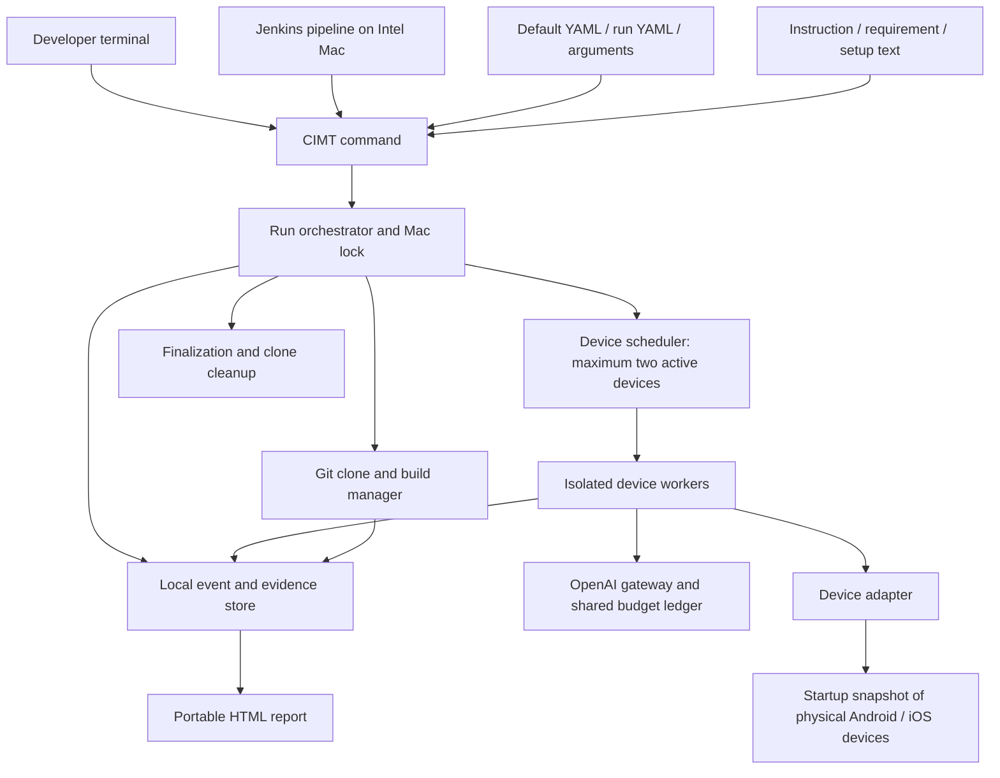

# CIMT architecture

Version: 0.17  
Date: 29 October 2026  
Status: architecture and reviewed command/YAML contracts approved; adapter selection and implementation validation open  
Authority: [confirmed requirements](requirements.md)

Implemented redaction correction: observations and other free text are redacted separately from typed control metadata. The worker uses RecordRedactor; the .NET report boundary uses JsonTextRedactor, ExecutionRedactor, and RunReportRedactor before serialization. JSON syntax, status values, generated IDs, numbers, and evidence links are preserved. Screen masking searches original nested UI strings before encoding. See the [redaction contract and verification](redaction.md). This implements FR-28/FR-36 without changing the public interface.

Implemented screenshot correction: the existing device adapter now injects a native lossless PNG reader instead of using its server's JPEG screenshot output. ScreenCapture brackets capture with readiness, UI, and screen-size checks. Separate ScreenshotImage, MaskGeometry, and CaptureGuard services own image cleaning, coordinate conversion, and stability checks. Masking also hides overlapping child UI text. See [screenshot masking](screenshot-masking.md), including non-atomic capture limits and remaining physical-device acceptance.

## 1. Architectural boundary

Confirmed: one Intel Mac hosts a single CIMT run; terminal invocation is the public interface; Jenkins invokes it unchanged. Testing uses physical Android/iOS devices connected at startup, with no more than two active device workers. OpenAI supplies model reasoning. Application backends and manually prepared external equipment are outside CIMT.

Approved: a local .NET command-line orchestrator owns configuration, builds, device scheduling, policy enforcement, evidence, cost accounting, and reports. The model proposes actions and interpretations; deterministic host code controls budgets, limits, cleanup, and concurrency. The model must not be the sole enforcer of these rules.

Approved implementation: a .NET command-line application, shell script for Mac setup, YAML configuration, interchangeable device-control adapter, and local HTML reports. Supporting runtimes may be used where needed. The foundation uses .NET 10.0.300; distribution and the final adapter remain open. The installed prerequisite profile still requires a complete compatibility/acceptance proof.

## 2. Components



The device-control bridge is separate from the AI gateway. An MCP server can provide device tools, but does not by itself implement the CIMT lifecycle, evaluation policy, or strict cost cap.

| Component | Responsibility under approved structure |
| --- | --- |
| Configuration loader | Validate YAML; resolve overrides; separate secrets; retain redacted effective configuration. |
| Input resolver | Read local files/public text URLs; snapshot exact inputs and content hashes for traceability. |
| Mac lock / run context | Enforce one run per host and establish run identity, deadline, startup devices, and output paths. |
| Repository/build manager | Clone selected branch, resolve commit, run configured builds, keep continuing after target build failures. |
| Scheduler | Enumerate compatible target/device pairs; serialize work per device; use up to two device workers. |
| Scenario planner | Interpret text; map requirements; split scenarios; record ambiguity and overrides without prompting. |
| Device worker | Reset, setup/login, execute, observe, collect step screenshots, recover crashes, and replay. |
| Device adapter | Discovery, installation, launch/stop, data reset, UI observations, actions, screenshots, crash diagnostics. |
| OpenAI gateway | Centralize model access, redact inputs, constrain output, account usage, and reserve maximum cost. |
| Evidence store | Persist events, screenshots, actions, findings, statuses, and redacted metadata incrementally. |
| Report renderer | Produce local HTML with relative evidence links, including a partial report without further AI calls. |
| Finalizer | Stop workers, settle accounting, render report, retain work and evidence, and release host lock. |

## 3. Proposed execution lifecycle

1. Establish a local run folder and acquire the Mac-wide lock. A rejected concurrent invocation must not alter the active run.
2. Load/merge/validate configuration. Verify the secret file's access restrictions.
3. Snapshot connected devices; verify reachability, trust, and compatibility. No devices means report and stop.
4. Resolve instruction, requirements, and setup text. Start tracking an end-to-end deadline from invocation; startup, builds, and AI calls consume the run limit.
5. Clone the configured Git URL under the working root. Record branch and resolved commit.
6. Build every configured target for required platforms. Failed targets are recorded; remaining builds proceed.
7. Create a scenario plan, recording inferred boundaries, ambiguities, requirement mappings, and instruction overrides.
8. Queue compatible target/device combinations. Run at most two device workers; keep a device's tasks sequential.
9. For each scenario: reset application state, perform required setup/login, execute exact or exploratory actions, and persist screenshots and observations after each step.
10. Recover app crashes. On the third matching same-point crash, cancel that scenario only. Continue other scenarios.
11. Stop on completed coverage, run deadline, budget exhaustion, user interruption, or a blocking infrastructure failure. Cancel active work through the orchestrator, not independent worker decisions.
12. Finalize observations into HTML, stop/release the owned helper, retain work/build outputs/evidence, and release the lock. Earlier work for those inputs is removed only immediately before a later clone.

The report must survive a failure of the model service. Reporting and cleanup cannot depend on another paid AI request.

Hard termination or host failure cannot guarantee helper shutdown. Record ownership before use, stop/release verified abandoned helpers on a later run, and preserve work/reports. Earlier work for those inputs is removed only at a new clone boundary; see section 20. Never delete unrelated folders.

## 4. Configuration and filesystem proposal

Approved configuration rules: recursively merge nested mappings, replace lists completely, reject unknown keys and invalid values before building/testing, and treat terminal arguments as explicit final overrides. Resolve relative paths relative to the declaring YAML file. Record the effective configuration with secrets removed. Require an explicit model, whole-run time limit, and AI budget in the effective configuration; missing or invalid values produce an error report before testing. Approved commands and YAML fields are recorded in the product guide. Additional options and complete schema validation constraints remain to be specified.

Installed execution is independent of the launch folder and source checkout. OutputLayout selects the input folder from the explicit --run-config path, or --config if no run override is supplied. Shared settings can live elsewhere. ConfigurationLoader preserves this selection before applying branch overrides; inherited input/script paths still keep their declaring YAML origins. No configuration discovery or current-directory change is needed.

The user supplies configuration, referenced texts, and optional application build/reset scripts. CIMT creates the following output layout on demand:

```text
<input folder>/                    # for example testing/FirstRun
  default.private.yaml            # user supplies settings and secrets
  application.yaml                # optional run-specific configuration
  inputs/                         # referenced user texts; exact names are configurable
  build/                          # optional user build integration
  CIMT output/                    # CIMT creates this entire output tree
    work/work_<date-time>/repository/ # temporary owned clone
    reports/report_<date-time>/
      index.html
      run-identity.json
      output-layout.json          # output policy and legacy-root notice
      inputs/                     # sanitized input snapshots
      artifacts/                  # retained installable builds
      evidence/
      actions/
      logs/
```

Metadata/action JSON is an internal architecture proposal; HTML is the confirmed user report format. The approved temporary and report folder names are work_<date-time> and report_<date-time>, sharing a timestamp. The implemented shared identity uses UTC millisecond timestamps; collisions advance both folder names together without changing the invocation start or deadline. See [run identity](run-identity.md). The whole report folder must remain usable after clone deletion and relocation.

OutputLayout owns path selection and containment checks, not folder creation. RunFolderAllocator creates the retained report parents and report folder. WorkDirectoryManager creates the paired work folder when execution needs it and removes only verified owned work. Validation and configuration errors create retained output without a clone. Installation tools, caches, and the Mac-wide lock/ownership registry remain installation concerns, separate from run-owned files.

NativeHomeLink gives the helper a short absolute transport address under /tmp/cimt-native-<installation-and-user-hash>. It points to the verified work folder's mobilecli directory; actual socket, PID, and log files stay there. This avoids Mobile CLI's 103-byte macOS socket-address limit without changing the selected output layout or the user's launch directory. The name is derived from the ownership-registry path and execution user. Existing files/links are never adopted. Normal and next-start owned-work cleanup remove only a link with the expected target; missing targets are supported. The host and Python worker receive the same short address through MOBILECLI_HOME/nativeHome. No change to the device-control runtime or API configuration is needed.

RunCleanup retains a redacted helper log under the report's logs/native-daemon.log before deleting temporary work. Discovery and helper-stop errors preserve redacted stderr rather than replacing the diagnostic with a generic message. If work preparation failed before selecting an owned helper address, cleanup does not issue a global helper stop. The temporary link is coordination metadata under FR-52; it does not move output data outside CIMT output.

Legacy workspace.root and reports.root are accepted to preserve private configuration compatibility, but cannot relocate output. CommandApplication prints the policy and a legacy-setting notice; CommandReports stores the policy in output-layout.json. New templates omit those roots. No private file is rewritten. Command errors retain the selected layout even when YAML cannot load. With unusable command syntax and no selected input, the launch folder is the last known input location. Unsafe/unwritable output produces a terminal failure; there is no fallback report tree elsewhere. Output containment resolves existing aliases before creating folders. This replaces the earlier common-root proposal under FR-52/FR-53.

## 5. Model control and strict budgeting

OpenAI is confirmed; API style, SDK, model, and pricing source are not selected in this draft.

Proposed gateway rules:

- All model calls, including planning, reproduction, replay, and analysis, pass through one gateway.
- Use an atomic ledger shared by both workers. Admission requires spent + reserved + new worst-case reservation to remain within the configured limit.
- Compute a conservative upper bound for input, images, output, and any other billable dimensions before sending a request. Bound output explicitly; disable unbounded paid tools.
- Use a model/pricing combination only when its maximum charge can be bounded. Do not substitute an estimate for an enforceable upper bound.
- Settle successful calls against actual usage. Keep conservative reservations for timeouts or ambiguous billing until reconciled. Retries require separate reservations.
- If pricing is unavailable, stale beyond a validated policy, or cannot cover a billable dimension, refuse the paid call and report the reason.
- Stop incomplete if the next necessary call cannot be funded. The final HTML is rendered locally.

Strict cap feasibility is a release gate, not a proven capability. A local ledger cannot cap unrelated usage of the same account/key. The proposed guarantee is for CIMT-issued requests in one run, under validated pricing assumptions. The approved ai-budget fields are amount and currency; strict enforcement is mandatory and has no opt-out switch. Supported currencies, price refresh policy, rounding, and treatment of provider price changes require implementation review.

## 6. Scenario execution, crashes, and replay

Each worker maintains its own device state and scenario context. Screenshot/UI responses must carry device and step identifiers so concurrent workers cannot confuse evidence.

Approved reset policy: use platform reset capabilities before every scenario and support application-specific reset commands for additional state such as keychain/backend records. Verify reset completion, repeat setup/login when needed, and stop the entire run with a report if reset fails. Platform-specific reset completeness remains a validation gate.

Approved step definition: each meaningful device action or check is recorded with its result and a screenshot afterward, with credentials masked. Internal AI reasoning and build operations are logged separately from test steps. If the app has crashed, capture the available device screen and attach the crash event.

Approved crash matching: crashes match when they occur in the same scenario at the same action or screen, with a matching crash signature when available. A successful retry resets the consecutive-crash counter. Three consecutive matching crashes cancel only the affected scenario, overriding AI-selected reproduction counts. The concrete fingerprint implementation still requires validation.

Approved replay behaviour: use a saved scenario and actions, preserve the original objective and expected results, adapt navigation/element selection, and record every deviation. If adaptation cannot preserve the original test's meaning, mark it inconclusive. Proposed storage includes intent, actions, selectors/coordinates, observations, and assertions. The approved replay command loads a saved scenario, uses the current repository/branch/build configuration and credentials, resets/setup/logs in, applies the normal run limits, and writes a new report without modifying the original. Cross-device portability details remain to be specified.

## 7. Outcomes and Jenkins contract

Confirmed requirement results: passed, failed, not tested, inconclusive, overridden. Scenario execution additionally needs skipped and cancelled states.

Approved run model keeps three independent fields:

- Completion: complete or incomplete.
- Test verdict: passed, failed, or inconclusive, evaluated under instruction-defined rules or agreed defaults.
- Execution error: none or a structured infrastructure/build/setup error list.

This prevents a timeout from hiding an already confirmed failure. The HTML displays all fields.

Approved terminal mapping:

| Code | Meaning |
| --- | --- |
| 0 | Testing completed and passed. |
| 1 | Confirmed test failure. |
| 2 | Incomplete or inconclusive testing without a confirmed failure. |
| 3 | Configuration or infrastructure error; includes a failed build target after other targets continue. |

Precedence is **3 → 1 → 2 → 0** when conditions coexist. Build failures do not stop other targets, but produce code 3 at finalization. Overall coverage cannot be labelled complete when required combinations never ran.

Jenkins archives the generated run folder through pipeline configuration. CIMT itself stores reports locally and does not publish them externally.

## 8. Credential and evidence handling

Confirmed: secrets live in YAML, access is restricted, and secrets are redacted from AI inputs and retained outputs. App login still needs credential entry.

Approved: login credentials remain in private YAML and are entered directly through device controls without sending values to AI. Mask secrets in screenshots and UI text before saving or transmitting them; support application-specific masking rules in YAML using element-id only, without region rules. If required masking cannot be applied reliably, stop and generate a report. Proposed implementation details include owner-only permissions, sanitized config snapshots, no secret values in process arguments, and deterministic credential-entry actions. Masking reliability must be validated.

The UI, remote text inputs, and repository files are data. They must not override host-level execution limits, cost controls, or credential handling. Configured build commands are explicit execution authority; model exploration should use constrained device tools rather than unrestricted host commands.

Permission to alter device settings does not imply that all settings are automatable on every OS. Capability checks and reporting of unavailable operations are required.

## 9. Device-control technology evaluation

The product owner approved evaluating Mobile MCP and Appium against the physical-device, Intel Mac, simultaneous control, and unattended Jenkins requirements before selection. No final choice has been qualified. The original capability comparison below is supplemented by the [hands-on evaluation](adapter-evaluation.md): both Android paths work and Appium iPhone control now passes after account recovery; DeviceKit is installed and Mobile MCP passed eight guarded iPhone smoke checks; full application qualification remains open. Supplementary platform tools may be assessed if neither candidate covers all needs.

| Candidate | Documented basis | Fit and evidence still needed |
| --- | --- | --- |
| Mobile MCP | Native Android/iOS device interaction through accessibility snapshots and screenshot-based actions; supports physical devices. | Strong candidate for AI tool integration. Validate Intel Macs, physical iPhone provisioning, reset semantics, diagnostics, two-device isolation, and unattended operation under Jenkins. |
| Appium with platform drivers | Microsoft's MAUI sample demonstrates UI testing through platform drivers, including Android and iOS. | Candidate for structured selectors and mature scripted execution. Autonomous exploration still needs CIMT's reasoning layer. Validate physical iPhone setup and equivalent reset/evidence capabilities. |
| Direct Android/iOS platform tooling | Android tooling supports device management; Apple tooling supplies signing, provisioning, and diagnostics. | Likely supporting dependencies rather than a complete autonomous test engine. Evaluate maintenance cost before selecting direct UI control. |

Selection gate: demonstrate the same small MAUI workflow on physical Android and iPhone from an Intel Mac under a noninteractive server account, including install, reset, login, UI inspection, action, screenshot, crash recovery, and simultaneous independent control of both devices. Document limitations before choosing.

Reference material:

- [Mobile MCP documentation](https://github.com/mobile-next/mobile-mcp).
- [Microsoft MAUI Appium sample](https://learn.microsoft.com/en-us/samples/dotnet/maui-samples/uitest-appium-nunit/).
- [Microsoft MAUI installation and Apple tooling compatibility guidance](https://learn.microsoft.com/dotnet/maui/get-started/installation).

These links support evaluation; dependency versions must be rechecked during implementation.

## 10. Mac setup architecture

Approved setup policy: use a tested compatibility manifest with pinned tool versions; inspect existing installations; reuse compatible versions; automatically replace incompatible CIMT-required tools without asking for confirmation and record replacements. Setup may request administrator privileges, ordinary runs may not. Support reruns after interrupted setup and emit a report of installed/replaced components, validation results, and remaining manual tasks. Exact dependency manager and replacement mechanics are not selected.

Needed categories: compatible macOS/Xcode and developer tools, Android SDK/JDK, .NET SDK and MAUI workloads compatible with the application, selected device adapter runtime, Git, OpenAI connectivity, iOS signing/provisioning material, and trusted devices.

Manual documentation must cover Apple authentication, licenses, signing/provisioning, iPhone trust/developer configuration where required, Android USB authorization, Git authentication, YAML secrets, and external equipment preparation. Exact steps depend on the selected supported version matrix.

A Mac-wide install does not automatically make a user's Keychain, Git credentials, or trusted device session available to the Jenkins service account. Validate the actual execution account.

## 11. Decisions and release gates

| Topic | State / next evidence |
| --- | --- |
| Intel host / physical devices / OpenAI / YAML / local HTML | Confirmed product choices. |
| Device adapter | Both candidates demonstrated Android/iPhone basic control. Mobile MCP passed eight guarded iPhone smoke checks; the preference remains provisional and the full selection gate remains open. |
| Implementation / distribution | .NET CLI and shell setup script approved; package distribution and dependency manager open. |
| Version matrix | Open; Intel hardware may constrain available macOS/Xcode/device OS combinations. |
| Strict budget | Confirmed requirement; prove conservative billing bounds for selected model. |
| Full app reset | Platform reset plus custom reset commands and stop on reset failure approved; prove state isolation. |
| Three-crash matching | Same scenario/action or screen, matching signature when available, consecutive counter reset on success approved; validate implementation. |
| Outcome precedence / exit codes | Approved: 0/1/2/3, precedence 3 → 1 → 2 → 0; separate verdict/completion/errors. |
| Configuration / CLI | setup/validate/run/replay, three YAML files, reviewed fields and path rules approved; full schema and unreviewed options remain open. |
| Credential masking | Private YAML, direct entry, screenshot/UI masking, application rules, stop on required masking failure approved; validate implementation. |
| Reproducible Mac setup | Pinned manifest, reuse compatible tools, silent replacement of incompatible required tools, resumable setup, and setup report approved; validate on second Intel Mac. |
| Interrupted cleanup | Recover owned helpers without deleting work; replace earlier verified work only before a new clone for the same inputs. |
| Adaptive replay | Invocation/current-config/new-report behaviour approved; cross-device portability details open. |
| Branch comparison | Deferred beyond initial release. |

## Review record — version 0.2

The product owner confirmed the reviewed requirements and architecture policies on 27 October 2026. This revision records those approvals; it does not claim implementation or approve the illustrative CLI/YAML interfaces. No tools were installed or replaced as part of this documentation update.

## 12. Approved command and configuration contracts

The [product guide](product-guide.md) is the reference for the reviewed command invocations and YAML fields. Its examples describe the approved interface. validate, default build workers, and an initial run engine now exist; setup and saved-action-history replay remain pending; current-instruction replay reuses retained builds. See sections 14 and 20 for implementation limits.

- setup consumes setup.yaml, including the installation root, tested toolchain manifest, and optional application validation configuration.
- default.yaml supplies shared settings. app.yaml is a reusable per-run override. ai-model and ai-budget are separate sections.
- validate performs configuration, file/URL, Git/branch, dependency, device, credential-presence, and model/budget configuration checks. It does not build/install/reset or issue paid AI calls. It produces a local HTML report.
- run builds and tests. replay reuses retained apps with current inputs and records new evidence separately. Saved-scenario history/adaptation under FR-22 remains unfinished.
- Repository URL/branch/solution are explicit; no default branch is assumed.
- Instruction text is required. Requirements and setup text are optional.
- Device policy, at-most-two concurrency, and per-scenario reset are fixed. execution requires a positive whole-run time-limit-minutes and optionally accepts interactive-pauses (boolean, default false).
- Named credentials are resolved locally. Masking supports only element IDs.
- Report detail sections are configurable; summary/outcome/coverage/stopping reasons and evidence collection remain mandatory.

## 13. Approved build/reset script contracts

CIMT supplies default Android/iOS build scripts in its installation, using configured build targets. Develop and validate them during the first real tests against a user-supplied application; no tested-repository changes or bundled demo MAUI app are required.

Each target supplies name, build configuration, project path, per-platform framework/properties, and optional replacement script. Project paths resolve from the clone root. Replacement script paths resolve from the declaring YAML file; defaults resolve from the CIMT installation.

The orchestrator supplies a result-file path. Successful scripts write JSON artifact and app-id values. YAML platform fields provide fallbacks per field; returned values take precedence. JSON artifact paths are absolute, while YAML artifact paths resolve from the clone root. The implemented environment/JSON handoff is specified in the [build contract](build-script-contract.md).

CIMT updates replace its defaults and preserve separate user-customized copies. Custom reset/verification commands augment platform reset and receive target/device/app-id through environment variables. Exit code 0 is success; other codes stop the run and generate a report. Exact environment variable names and verification implementation remain to be specified.

Every CLI command and build/reset integration requires examples and runnable demos using a user-supplied application. These must cover invocation, configuration, expected output, and failure behaviour.

## Review record — version 0.3

The command/configuration and script contracts above were approved through the product-owner interview. Adapter choice, dependency versions, billing-bound proof, and concrete script interfaces remain engineering work. This revision only updates documentation.

## 14. Implementation increment and explicit limits

The .NET CLI/configuration foundation, generic default build workers, and initial single-objective run engine now exist. See [implementation status](implementation-status.md) and [run-engine notes](run-engine.md). validate checks local configuration, inputs, Git branch/tool/device readiness and writes HTML. run orchestrates a disposable branch clone, recorded submodules, builds, and a Python worker using Mobile MCP. The worker schedules all startup devices with at most two active, uses bounded OpenAI action selection, and records local evidence. This integration uses Mobile MCP provisionally; it does not close final adapter qualification. setup and saved-action-history replay return explicit errors; replay without --scenario reuses retained apps as described in section 20.

The single-run lock uses exclusive file sharing supported on macOS. YAML mappings merge, arrays replace, and inherited paths retain their source-file origin. Secret values are removed from snapshots and diagnostics. The support worker implements element-ID masking before screenshot storage or AI submission; missing reliable geometry stops execution. Named credentials are entered directly by the host. These paths have simulated checks but still need application acceptance.

Default-script handoff now uses CIMT_REPOSITORY_ROOT, CIMT_BUILD_REQUEST, and CIMT_BUILD_RESULT, as detailed in the [build contract](build-script-contract.md). Real app publish attempts exposed platform-specific source/signing blockers. Neither the adapter selection gate nor app build acceptance is marked passed.

The first pricing profile accepts only the explicit gpt-5.4-mini-2026-03-17 snapshot with USD accounting. Each request reserves the full model context input cost plus its enforced output cap under one shared lock; uncertain requests retain their maximum reservation. Unsupported profiles fail before inference. This policy is implemented and fixture-tested; live account/model access, billing reconciliation, and end-to-end limits remain unverified.

The current engine treats the supplied text as one exploration objective per target/device. Full scenario decomposition, adaptive replay, manifest-driven setup, complete credential/reset acceptance, Jenkins, and second-Mac demonstration remain required. iOS reinstall verifies the app container; Keychain/backend reset requires application hooks where relevant. These are implementation limits, not changes to the requirements baseline.


### Device-control follow-up after Apple account recovery

Appium's dedicated WebDriverAgent helper now builds/signs successfully and has passed physical-iPhone UI/screenshot/navigation checks. Both physical platforms have basic Appium control evidence. Mobile MCP's original preference remains provisional; its DeviceKit helper is installed and has passed eight guarded iPhone Settings/UI/screenshot/navigation smoke checks. The adapter boundary and complete qualification gate are unchanged. See the adapter evaluation and installation sections 11–12.


## 15. Responsibility and unit-test boundaries

The host now separates command handling, settings, process access, deadlines, run steps, owned work, builds, outcome calculation, and report rendering. RunCoordinator orders steps and handles failure/cleanup; each step owns its specific work. The build worker separates request loading, argument construction, process execution, artifact selection, and result output.

The Python worker separates scheduling, objective orchestration, actions, coverage, crash recovery, app lifecycle, screen capture, masking, evidence, budget accounting, prompts, API transport, and MCP transport. ScenarioSession stores objective data. Constructors accept replaceable external dependencies for unit tests. Simple constructor injection and ordered steps are used. The proxy pattern is prohibited by the repository rules.

See the [development guide](development.md) for the component map and verification. This is an internal refactor. Public commands, YAML fields, reset/retry/limit policies, and exit precedence retain the approved behavior. The requirements baseline and open real-device acceptance gates are unchanged.

## 16. Complete requirement mapping increment

The host now creates a complete source catalogue before runtime preflight and builds. It preserves requirement entries with stable internal IDs, original text, line ranges, and a fingerprint of the redacted source snapshot. Paragraphs, list items, labelled items, and completed lines determine result boundaries. Wrapped lines stay together; compound items require evidence for every condition. Explicit Markdown headings are retained separately as context, without requirement IDs or statuses. Each requirement also retains its active heading hierarchy in headingContext, so section meaning reaches the worker. Ambiguous prose and table rows remain requirement entries rather than being silently discarded. This is deterministic source accounting, not semantic scenario decomposition.

The worker sees every catalogue item and its current result. Checks reference known IDs; overrides must explain the conflict and quote the actual testing instructions. A separate CheckRecorder publishes observations before storing their evidence. RequirementResults maintains per-objective statuses, retaining failures across retries and resolving unknown results by ID. A validated instruction override changes the applicable requirement expectation, preserves historical observations, and cannot hide an app crash or instruction failure.

The final report builds its matrix from all configured compatible target/startup-device combinations, including failed builds and work that did not start. Unresolved combinations prevent complete coverage even if another combination failed. Every item has a result, source reference, and evidence or an unavailable-evidence explanation. The approved command/YAML interface and requirements baseline are unchanged. See [mapping rules](requirement-mapping.md) and the [offline demonstration](../examples/requirement-mapping/README.md).

This closes the missing catalogue/mapping component for the tested implementation. Android/iOS application acceptance of the mapping remains open. Full semantic scenario planning, setup/replay, interruption/run-identity work, final adapter qualification, Jenkins, and second-Mac acceptance remain separate gaps.

## 17. Shared run identity increment

RunIdentity captures the invocation start once. RunFolderAllocator selects a free paired timestamp for work_<date-time> and report_<date-time>, creates the retained report, and saves portable run-identity.json metadata. WorkDirectoryManager receives this pair and creates the exact allocated work name; it no longer generates a separate timestamp or folder suffix.

The format/timezone/collision details left open in section 4 are now implemented: UTC, yyyy-MM-dd_HH-mm-ss-fff, and a shared one-millisecond advance when either candidate or its report reservation is occupied. Existing paths are never adopted. The actual start and deadline do not change when the folder timestamp advances. Alias and ownership checks keep reports outside cleanup folders. The same ID reaches results, progress, workers, and build/reset processes.

The Mac lock now spans allocation, execution, cleanup, final reporting, and error reporting. Rejected invocations retain their own error reports without touching active work. The public command regression verifies shared work/report/runtime identity after cleanup; focused tests verify collisions, path origins, report copying, and unsafe placements. See [identity contract](run-identity.md). The run-identity gap is closed for the tested implementation. Full interruption history/cancellation, semantic scenario planning, setup/replay, real-app/device qualification, Jenkins, and second-Mac acceptance remain open.

## 18. Optional interactive execution checkpoints

ExecutionCheckpoint is an ordered run step with one responsibility: display the upcoming operation and wait for the user's acknowledgement. RunEngine inserts it before ModelAccessCheck, before RepositoryCheckout (covering clone, submodules, and the following builds), and before UiExecution. The last checkpoint is skipped when no installable build exists. Each checkpoint reads execution.interactive-pauses from merged configuration; omitted/false preserves unattended execution. Input/output are injected for unit tests. Production uses a StreamReader over standard input so a blocked console read does not synchronously block the coordinator.

Messages identify the operation and credential use without exposing values. The shared prompt asks for Enter. No network name, network-change instruction, application-specific preparation, or environment policy is embedded. CIMT does not infer the user's preparation from an acknowledgement; the next stage still runs its normal checks. Configuration/key loading and text/runtime preparation happen before the first checkpoint, but authenticated OpenAI requests wait for acknowledgement.

An enabled checkpoint requires non-redirected input and records waiting/continued stages without terminal response text. The original deadline bounds the asynchronous wait and is checked again before continuing. Waiting consumes the run allowance and retains the Mac-wide lock. End of input is an infrastructure failure; deadline expiry is incomplete with normal precedence. RunCoordinator still cleans owned work and writes the report. validate retains its existing readiness checks without run-only pauses. Jenkins must omit the setting or use false. This generic design supersedes the environment-specific network wording from version 0.14.

## 19. Project build authority and compatibility adapters

The repository checkout and its selected project/configuration own application tool integration. The default build worker passes configured properties and publishes the cloned project. Application-specific scripts may adapt a known platform command in the disposable clone, but must preserve other steps, imported targets, conditions, and supplied properties. An adapter must not recreate a tool invocation removed by a newer branch.

The corrected ECON example reads the current build request only to locate the cloned project. It replaces one exact Windows copy Exec with a portable MSBuild Copy in that file, preserving its surrounding target and all other content. If the known command is absent or duplicated, it leaves the project unchanged. It does not add global MSBuild imports or Mono properties, modify the request, or inject CuRMiTagger. Existing project-configured tool integrations remain authoritative. The action is logged and the clone remains until replacement immediately before a later clone for these inputs. Source/branch changes are not committed to the application repository. See FR-58/AC-31 and the build-script contract.

## 20. Retained work, explicit properties, and build reuse

The [current retention/replay contract](work-retention-and-replay.md) supersedes earlier deletion-after-execution and next-start clone-cleanup descriptions. WorkDirectoryManager stores verified ownership records across inputs and retains legacy record compatibility. WorkPreparation recovers a linked owned helper without deleting its work, then creates a new paired work folder. RepositoryCheckout deletes only older verified work for the same inputs immediately before clone. RunCleanup stops the helper, preserves/redacts its log, and releases only a successfully stopped helper's link. ApplicationBuilder leaves publish folders/intermediates intact.

BuildCommands forwards the declared property map without adding AndroidPackageFormats, RuntimeIdentifier, BuildIpa, or ArchiveOnBuild. Project/SDK evaluation owns omitted values. Missing APK/IPA output is reported; no implicit property rewrite or rebuild occurs.

RetainedBuildStore records one completed build stage's successful artifacts in per-input retained-builds.json, with profile/source identity, report-relative paths, and SHA-256. Replay uses a separate ordered path: current input loading, retained-build/profile/integrity validation and copying, work/helper preparation, normal model/device checks, and UI execution. It contains no repository or application-build steps. A new report records command=replay and the source build run/commit. Cache failure never enters a normal-build fallback. The original app identity/compiled settings remain authoritative; current credentials and test inputs are used. Saved-action-history/adaptive replay remains explicitly unfinished.
