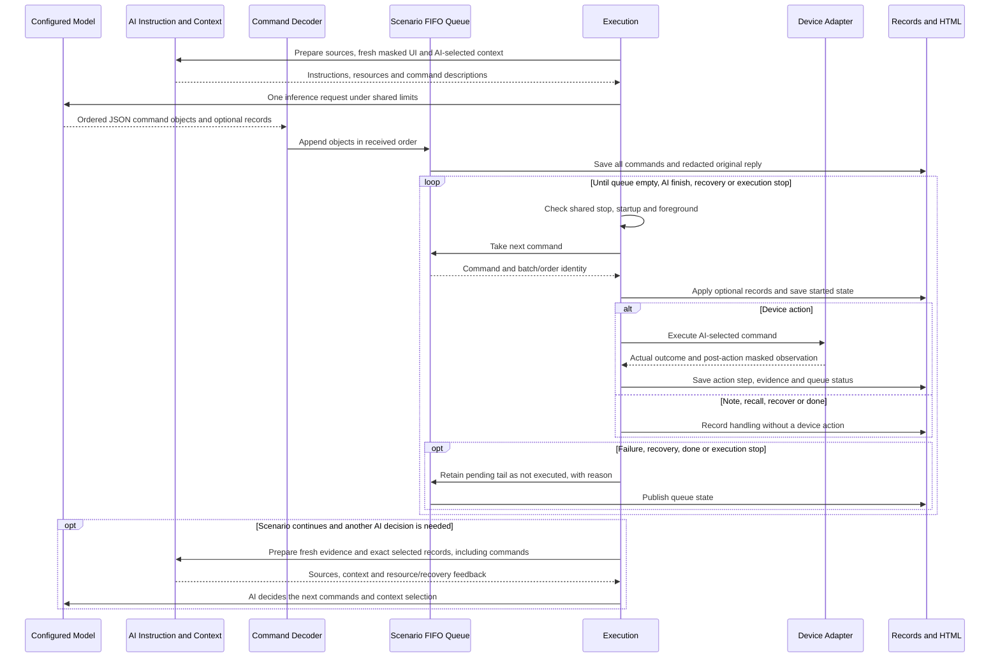

# Ordered AI command queue

Updated: 1 November 2026. Implements FR-99 / AC-69. Source and offline verification are complete; installation and live qualification are separate.

## Contract and boundaries

The product owner requested command objects stored and executed one after another. CIMT uses FIFO: first received, first executed. A LIFO stack would reverse the AI's order. Each scenario on each device has its own queue.

The decoder and queue are execution components, not new layers. command_reply.py reads explicit command objects. command_queue.py stores order and execution state, without device, provider or stopping-policy calls. ScenarioRunner takes commands one at a time and uses the existing ActionExecutor and observation path. Device Adapter owns device I/O; Execution Stopping Policy retains final stopping scope. AI Instruction and Context supplies inputs and retained information only. Test Planning and Exploration retains AI-owned plans and exact context selections. The named layers keep their existing separate folders.

AI owns the testing logic: what to test, which actions to choose and which history to retrieve. Queue management records what CIMT has received and performed. It does not approve the meaning of a response, select replacement controls or decide which history is relevant.

## Decoding and order

The Responses text transport accepts one JSON object, an array of objects, or consecutive JSON objects, with optional whitespace between them. For example, these commands execute tap before back:

```json
[
  {"action":"tap","ref":"@settings"},
  {"action":"back"}
]
```

The same objects may be adjacent instead of inside an array. The decoder normalizes supported command arguments using existing defaults. Optional plan/check/context/recovery records do not approve dispatch. Unknown fields remain in the full original reply for review.

If a readable prefix is followed by unreadable text, the explicit prefix is retained and the unreadable text becomes a note. Prose and fenced text are not searched for embedded commands. A non-object JSON value cannot manufacture a command; any previously decoded prefix survives with resource feedback. If no command object can be read, the reply remains a note. Provider refusals/incomplete responses keep their existing infrastructure policy.

Every decoded object is queued before the first dispatch. Each row has a scenario-local id, batchId, zero-based position, response and status. The full original modelResponse is stored once per batch, on its first row. Optional metadata is applied as each command is taken, rather than presenting later commands as already observed actions.

## Execution and interruption

While commands remain queued, CIMT takes the next command without a new inference request. Before each iteration, the normal shared stop, startup and foreground checks run. Every device action still gets post-action crash checks and masked observation. Queuing does not disable credential-destination verification, masking, supported-capability checks or coordinate bounds. References may become unavailable after navigation; the adapter returns the actual outcome, and CIMT does not guess another target.

A note or recall command is handled without a device action. recall changes the AI's selected context; if another command follows in the same batch, it runs before a new provider request. A done command ends the objective and leaves any later commands not executed. A recover command requests fresh evidence and an AI recovery decision; the rest of that batch is not executed.

An answered interaction failure, observed crash or repetition recovery also leaves the pending tail not executed and returns to AI with resource feedback. The AI can retrieve those records and decide which commands to issue next. Fatal infrastructure errors retain their existing scope. Cancellation, shared limits, leaving the permitted app workflow or ending a scenario preserve the remaining commands. No deferred command resumes automatically in another batch or replay.

## Records and privacy

| State | Meaning |
| --- | --- |
| queued | Received and retained, not yet taken for execution. |
| started | Taken from the queue; completion is not yet known. |
| executed | ActionExecutor returned successfully; observation may still report a problem. |
| handled | A note, recall, recover or done command was handled without a device action. |
| failed | The command did not return successfully; reason/step retain the available diagnostic. Partial effects are possible. |
| interrupted | Execution stopped while this command was active; completion is not confirmed. |
| not executed | Still pending when execution deferred or ended; reason explains why. |

An executed command is not a passed requirement or proof of a correct application response. The actual step, observation, checks and crash records carry that evidence. A failed/interrupted credential operation can have partial effects; the status does not claim rollback.

JSON and HTML retain batch/order/state, actual step number and reason. The HTML Devices scenario shows the queue separately from the action steps and exposes one complete reply per batch. Escaping prevents reply text from becoming HTML. RecordRedactor and ExecutionRedactor preserve host-generated identities/control metadata while scrubbing free text at both boundaries. Existing reports are not rewritten.

The commands context collection exposes the stored rows using existing AI-owned exact selection. AI can select an id, latest, an exact @range or the whole collection. Counts remain in the resource catalogue. The host does not automatically include a relevant subset or silently trim command history. The existing payload allowance can request a smaller AI selection without deleting local records.

## Cost, packaging and verification

A provider reply containing several commands incurs one inference request. Taking another queued command makes no new provider call. Device observation work, shared accounting, time and cancellation checks remain. A fresh request after failure/recovery uses the configured model and normal budget reservation. Offline checks do not establish measured savings or live exploration quality.

Install the matching .NET report host and Python runtime together. The existing installer includes command_queue.py with the top-level runtime modules. No third-party source change, package dependency, public CLI command, YAML field, model or key is added.

Existing unittest suites cover decoding, FIFO state, one-request batches, action-free context handling, done, failure/recovery, cancellation/deadlines, exact context retrieval and privacy. Existing xUnit tests cover HTML states and host redaction. Runtime-policy and fake-tool CLI/lifecycle checks retain the public execution boundaries. No test project or alternative harness was added. No live replay was started for this source task.


