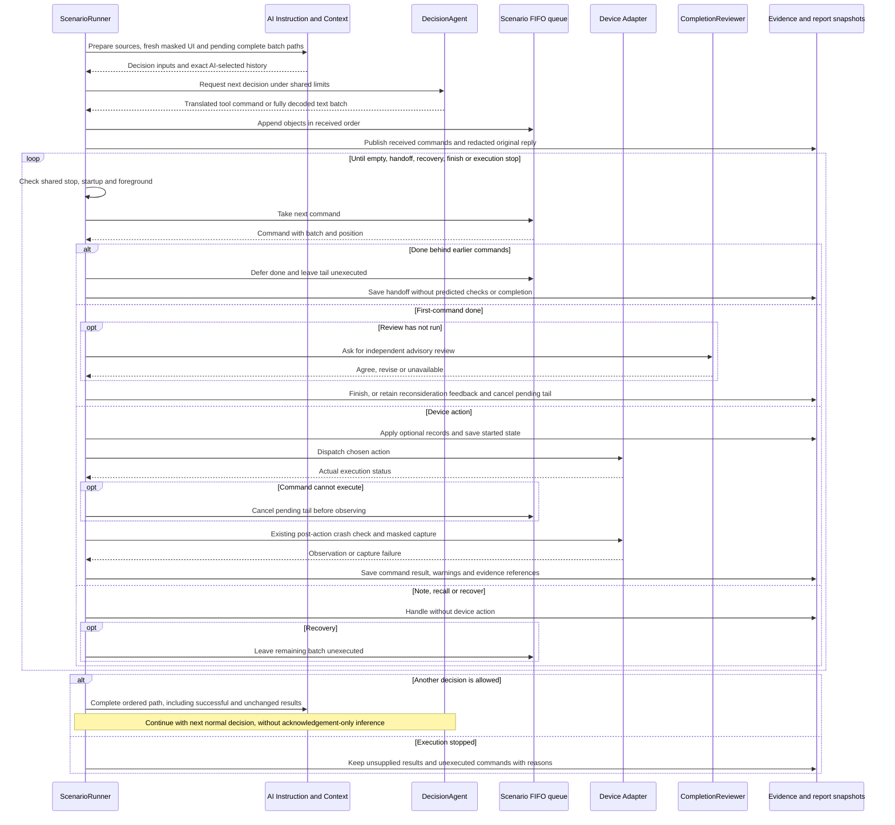

# Ordered AI command queue

> Contract and dated evidence: later refinements supersede earlier wording. Recorded test counts and live observations belong to their stated dates, not the current full-suite result. See [implementation status](implementation-status.md), [release readiness](release-1.0.md), and the [current usage guide](product-guide.md).

Updated: 1 November 2026. Implements FR-99 / AC-69. Source and offline verification are complete; installation and live qualification are separate.

## Contract and boundaries

The product owner requested command objects stored and executed one after another. TestPilot uses FIFO: first received, first executed. A LIFO stack would reverse the AI's order. Each scenario on each device has its own queue.

The decoder and queue are execution components, not new layers. command_reply.py reads explicit command objects. command_queue.py stores order and execution state, without device, provider or stopping-policy calls. ScenarioRunner takes commands one at a time and uses the existing ActionExecutor and observation path. Device Adapter owns device I/O; Execution Stopping Policy retains final stopping scope. AI Instruction and Context supplies inputs and retained information only. Test Planning and Exploration retains AI-owned plans and exact context selections. The named layers keep their existing separate folders.

AI owns the testing logic: what to test, which actions to choose and which history to retrieve. Queue management records what TestPilot has received and performed. It does not approve the meaning of a response, select replacement controls or decide which history is relevant.

## Decoding and order

The default agent supports registered tool calls as described in [decision agent](decision-agent.md#registered-tools). A tool call is translated to a command without operating the device. The Responses text transport also accepts one JSON object, an array of objects, or consecutive JSON objects, with optional whitespace between them. For example, these commands execute tap before back:

```json
[
  {"action":"tap","ref":"@settings"},
  {"action":"back"}
]
```

The same objects may be adjacent instead of inside an array. The decoder normalizes supported command arguments using existing defaults. Optional plan/check/context/recovery records do not approve dispatch. Unknown fields remain in the full original reply for review.

The decoder checks the complete reply before queuing any commands. A malformed suffix or a non-object command value makes the entire reply a note; no readable prefix is executed. Generic resourceFeedback identifies the JSON syntax error and its line/column, or the invalid command structure, states that no commands from this reply were executed, and explains the accepted formats with an array example. For comma-separated top-level objects, it explains that commas require enclosing array brackets. AI receives this information in the next normal request and chooses its corrected reply. The original reply remains redacted in the report. Prose and fenced text are not searched for embedded commands. This is mechanical transport feedback, not approval of the AI's testing decisions. Provider refusals/incomplete responses and shared limits keep their existing policies.

Every decoded object is queued before the first dispatch. Each row has a scenario-local id, batchId, zero-based position, response and status. The full original modelResponse is stored once per batch, on its first row. Optional metadata is applied as each command is taken, rather than presenting later commands as already observed actions.

## Execution and interruption

While commands remain queued, TestPilot takes the next command without a new inference request. Before each iteration, the normal shared stop, startup and foreground checks run. Every device action still gets post-action crash checks and masked observation. Queuing does not disable credential-destination verification, masking, supported-capability checks or coordinate bounds. References may become unavailable after navigation; the adapter returns the actual outcome, and TestPilot does not guess another target.

A note or recall command is handled without a device action. recall changes the AI's selected context; if another command follows in the same batch, it runs before a new provider request. A done returned first can end the objective and leaves later commands not executed. Under FR-101, done after other commands is deferred as batch handoff: its predicted checks/completion are not applied, later commands stay unexecuted, and actual results go to a fresh AI decision. A recover command requests fresh evidence and an AI recovery decision; the rest of that batch is not executed.

If a command cannot execute, TestPilot immediately cancels every pending command before post-action observation. This includes adapter interaction rejections and mechanical capability/argument failures. The failed command keeps its actual outcome; all pending commands become cancelled with the original redacted error. After the last attempted command, the next normal AI request includes the command/batch/order, actual error and cancelled-command count. A failure on the last queued command still provides feedback, with a zero count. There is no automatic retry or continuation of cancelled commands. AI may retrieve their records and issue new commands.

Successful batches have no separate acknowledgement-only request. Under FR-101, the normal next-decision request supplies the complete ordered batch path, even when AI omits historical context. It includes unchanged steps and observed intermediate navigation with compact evidence references, plus current evidence and AI-selected older context. An observed crash or repetition recovery can still leave the pending tail not executed and return recovery information to AI. Fatal infrastructure errors retain their existing scope. Run-stop, budget, time, unavailable transport or privacy failures can prevent another AI request; cancel/retain the pending queue and keep diagnostics in the report instead of bypassing those rules. Cancellation, shared limits, leaving the permitted app workflow or ending a scenario preserve the remaining commands. No deferred command resumes automatically in another batch or replay.

## Records and privacy

| State | Meaning |
| --- | --- |
| queued | Received and retained, not yet taken for execution. |
| started | Taken from the queue; completion is not yet known. |
| executed | ActionExecutor returned successfully; observation may still report a problem. |
| deferred | A finish behind commands handed actual batch results back for a fresh AI decision. |
| handled | A note, recall, recover or done command was handled without a device action. |
| failed | The command did not return successfully; reason/step retain the available diagnostic. Partial effects are possible. |
| interrupted | Execution stopped while this command was active; completion is not confirmed. |
| cancelled | Pending command removed after another command could not complete; it will not run automatically. |
| not executed | Still pending when execution deferred or ended; reason explains why. |

An executed command is not a passed requirement or proof of a correct application response. The actual step, observation, checks and crash records carry that evidence. A failed/interrupted credential operation can have partial effects; the status does not claim rollback.

JSON and HTML retain batch/order/state, actual step number and reason. The HTML Devices scenario shows the queue separately from the action steps and exposes one complete reply per batch. Escaping prevents reply text from becoming HTML. RecordRedactor and ExecutionRedactor preserve host-generated identities/control metadata while scrubbing free text at both boundaries. Existing reports are not rewritten.

The commands context collection exposes the stored rows using existing AI-owned exact selection. AI can select an id, latest, an exact @range or the whole collection. Counts remain in the resource catalogue. The host does not automatically include a relevant subset or silently trim command history. There is no separate local history byte allowance or automatic deferral. Provider context limits and shared budget admission still apply to the complete request.

## Cost, packaging and verification

A provider reply containing several commands incurs one inference request. Taking another queued command makes no new provider call. Success adds no acknowledgement call; complete successful and failing batch feedback is part of the next normal decision request, not an additional request. Device observation work, shared accounting, time and cancellation checks remain. A fresh request after failure/recovery uses the configured model and normal budget reservation. Offline checks do not establish measured savings or live exploration quality.

Install the matching .NET report host and Python runtime together. The existing installer includes command_queue.py with the top-level runtime modules. No third-party source change, package dependency, public CLI command, YAML field, model or key is added.

Existing unittest suites cover decoding, FIFO state, one-request batches, action-free context handling, done, failure/recovery, cancellation/deadlines, exact context retrieval and privacy. Existing xUnit tests cover HTML states and host redaction. Runtime-policy and fake-tool CLI/lifecycle checks retain the public execution boundaries. No test project or alternative harness was added. No live replay was started for this source task.



FR-101 adds the [complete batch feedback contract](batch-feedback.md), mandatory new execution results, ANR warnings, identity-based evidence reuse and first-command-only objective completion. A finish predicted before its batch ran cannot replace actual result assessment. Closed scenarios retain explicit unsupplied delivery status when no further request is permitted.
